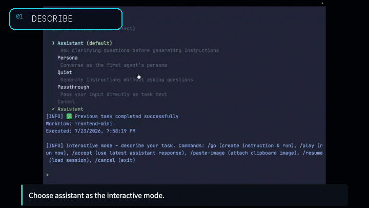

# TAKT

<p align="center">
  <picture>
    <source media="(prefers-color-scheme: dark)" srcset="./docs/assets/takt-logo-dark.svg">
    
  </picture>
</p>

<p align="center">
  <a href="https://www.npmjs.com/package/takt"></a>
  <a href="https://github.com/nrslib/takt/stargazers"></a>
  <a href="https://github.com/nrslib/takt/actions/workflows/ci.yml"></a>
  <a href="./LICENSE"></a>
  <a href="https://discord.gg/R2Xz3uYWxD"></a>
</p>

<p align="center">
  <a href="./README.md">English</a> |
  <a href="./docs/README.ja.md">日本語</a> |
  <a href="./docs/README.zh-CN.md">简体中文</a>
</p>

<p align="center">
  <a href="https://nrslib.github.io/takt/#tutorial">
    
  </a>
</p>

**Stop babysitting AI coding agents.**

TAKT is an open-source CLI that turns AI coding agents into repeatable development workflows. Define planning, implementation, review, fix loops, human checkpoints, permissions, and output contracts in YAML, then run tasks with isolated worktrees and traceable logs.

Instead of asking one agent to remember the whole process, TAKT gives each step its own role, context, and transition rules. Agents can code, but the workflow decides what happens next.


- Run plan → implement → review → fix loops as explicit workflow steps
- Keep context focused with step-specific personas, policies, knowledge, instructions, and output contracts
- Execute queued tasks in isolated worktrees and inspect logs and reports afterward
- Use Claude Code, Claude SDK, Codex SDK, OpenCode SDK, Pi SDK, the official DeepSeek Harness SDK, Cursor, GitHub Copilot CLI, or Kiro as providers

**T**AKT **A**gent **K**oordination **T**opology orchestrates multiple AI agents with review loops, managed prompts, and per-step permissions.

Talk to AI to define what you want, queue it as a task, and run it with `takt run`. Planning, implementation, review, and fix loops are defined in YAML workflow files, so the process is not left to the agent's discretion. TAKT coordinates Claude Code, Codex, OpenCode, Pi, the official DeepSeek Harness SDK, Cursor, GitHub Copilot CLI, and Kiro CLI as agents with different roles, permissions, and context.

TAKT is built primarily for AI coding workflows, but the same model applies beyond coding: any task where multiple AI agents need to coordinate, or where review, judgment, and feedback loops can improve task quality.

TAKT is built with TAKT itself (dogfooding).

## Why TAKT

AI coding agents do not automatically create a stable development process. In long-running work, they forget instructions, accumulate polluted context, blur implementation and review responsibilities, and often force humans to repeat the same feedback again and again.

Adding more rules to prompts, `CLAUDE.md`, or skills can help, but it cannot enforce the process. Whether the rules are followed is still left to the agent's behavior.

TAKT treats AI agents as something to be controlled from the outside, not simply trusted.

Workflows define the phases, and each step receives its own persona, policy, knowledge, instruction, and output contract. TAKT manages implementation, review, fix, and re-review flows declaratively. By separating responsibilities, knowledge, and constraints, then giving each agent only what it needs for the current step, TAKT improves task quality without bloating context.

Reviews cannot be silently skipped. Findings route work back to fix steps, and human judgment can be requested when needed. Tasks run in isolated worktrees, and each step leaves logs and reports so the path from task to PR remains traceable.

TAKT runs all of this as a reusable agent process built from roles, phases, judgments, and feedback loops, so the development process stays reviewable and reproducible without constant human intervention.

## Try It in 5 Minutes

From a Git repository with at least one commit:

```bash
npm install -g takt

# Install the SDK for the default provider (claude-sdk)
takt install claude-sdk

# Talk to AI, describe a task, use /go, then choose "Save as Task"
takt

# Execute queued tasks in isolated worktrees
takt run

# Review diffs, merge, retry, requeue, or delete task branches
takt list
```

If this is your first run, configure a provider in `~/.takt/config.yaml` or use the API key environment variables listed in [Configuration](#configuration). SDK-based providers (`claude-sdk`, `codex`, `opencode`, `pi`, and `deepseek-harness`) run with Node.js; run `takt install <provider>` once before using one. CLI-based providers require their external CLIs.

## CodeRabbit Review Loop

On GitHub, run `takt caccia <PR-number>` to wait for CodeRabbit reviews, handle unresolved bot threads in isolated clones, and keep a decision report for each iteration. Merge workflows call the loop through an explicit `caccia` effect. `caccia.enabled` controls whether that effect waits for CodeRabbit and defaults to false. Push and PR publication do not start Caccia implicitly. See the [CLI reference](./docs/cli-reference.md#takt-caccia) and [configuration guide](./docs/configuration.md#caccia-review-loop).

### Video Tutorial

Follow the [written tutorial](./docs/tutorial.md) with these hands-on walkthroughs:

| Chapter 1 | Chapter 2 |
|-----------|-----------|
| [](https://youtu.be/HUcFFvOy39I) | [](https://youtu.be/UIlM2iM-rmA) |

## TAKT vs Plain AI Coding Agents

| Plain AI coding agents | TAKT |
|------------------------|------|
| The prompt asks the agent to follow a process | The YAML workflow owns the process |
| Review steps can be forgotten or skipped | Review and fix loops are explicit transitions |
| One long context keeps growing | Each step receives only the context it needs |
| Implementation and review responsibilities blur | Personas, permissions, and output contracts separate responsibilities |
| Work often lands directly in the current tree | Queued tasks run in isolated worktrees by default |
| The path from task to result is hard to audit | Logs and reports preserve the path from task to PR |
| The same process must be recreated by memory | Workflows are reusable, reviewable, and versionable |

## Requirements

TAKT requires Node.js `>=22.22.0` and Git `>=2.38` (goal completion compares trees with `git merge-tree --write-tree`).

The provider you choose determines whether you need to install an external CLI or can run on Node.js alone via a TypeScript SDK.

The default provider is `claude-sdk` (Claude Agent SDK). `claude` is an alias for `claude-sdk`.

To continue using the Claude Code CLI, select `claude-headless` in your provider configuration or pass `--provider claude-headless`. Move any provider permission profile to the selected provider name; the default is now `claude-sdk`, so an old `provider_profiles.claude` setting may no longer apply. Existing sessions labeled `claude` start fresh. See [permission resolution](./docs/configuration.md#permission-resolution-priority) for the migration details.

These providers run via SDK (no CLI required, Node.js only). The SDK is not bundled with TAKT; run `takt install <provider>` once before use, and `takt update` after upgrading TAKT. In a terminal, TAKT offers to install a missing SDK; in CI and other non-interactive runs, install it beforehand. See [Managed SDK installation and updates](./docs/cli-reference.md#managed-sdk-installation-and-updates).

- `claude-sdk` — `@anthropic-ai/claude-agent-sdk`
- `codex` — `@openai/codex-sdk`
- `pi` — `@earendil-works/pi-coding-agent`

The `deepseek-harness` provider uses the official TypeScript SDK and its runtime. Run `takt install deepseek-harness` before use. It supports Linux x64/arm64 with glibc `>= 2.28` and macOS arm64 `>= 14.0`. Sessions cannot restore history after the runtime exits; start a new TAKT session or run after changing its settings. See the [configuration guide](./docs/configuration.md#deepseek-harness-deepseek-harness) for credentials, supported tools, permissions, migration, and recovery.

These providers require an external CLI:

- `opencode` — [OpenCode](https://opencode.ai/) CLI, plus `takt install opencode` for its SDK. v2 is the default; select v1 explicitly ([migration settings](./docs/configuration.md#opencode-v1v2-selection)).
- `claude-headless` — [Claude Code](https://claude.ai/code)
- `claude-terminal` — [Claude Code](https://claude.ai/code) driven in an interactive terminal session (also requires [`tmux`](https://github.com/tmux/tmux))
- `copilot` — [GitHub Copilot CLI](https://docs.github.com/en/copilot/github-copilot-in-the-cli)
- `cursor` — [Cursor Agent](https://docs.cursor.com/)
- `kiro` — [Kiro CLI](https://kiro.dev/docs/cli/headless/)
- `devin` — [Devin CLI](https://devin.ai/)

Optional:

- [GitHub CLI](https://cli.github.com/) (`gh`) — for `takt #N` (GitHub Issue tasks)
- [GitLab CLI](https://gitlab.com/gitlab-org/cli) (`glab`) — for GitLab Issue/MR integration (auto-detected from remote URL)
- Java 17 or later (`java` on `PATH`) — for the model-checking stages of `/verify` in formal specification mode (`quint verify` and the Alloy Analyzer). The Quint CLI itself is bundled with TAKT; see [Formal Specification Verification](./docs/formal-verification.md) for what is downloaded on first use

> **OAuth usage:** Whether OAuth is permitted varies by provider and use case. Check each provider's terms of service before using TAKT.

## Quick Start

### Install

```bash
npm install -g takt
takt install claude-sdk   # or codex, opencode, pi, deepseek-harness
```

With Nix flakes:

```bash
nix run github:nrslib/takt
nix profile install github:nrslib/takt
```

The Nix package installs the TAKT CLI itself. External CLI providers, `git`, and `gh`/`glab` still need to be installed and available on `PATH` or configured separately as described in [Requirements](#requirements).

### Talk to AI and queue tasks

```
$ takt

Select workflow:
  ❯ 🎼 default (current)
    📁 🚀 Quick Start/
    📁 🛠️ Development/
    📁 🔍 Review/

> Add user authentication with JWT

[AI clarifies requirements and organizes the task]

> /go

Proposed task:
  ...

What would you like to do?
  ❯ Save as Task           # ← normal flow and initial selection
    Create Issue
    Execute here now
    Continue editing
```

Choosing "Save as Task" saves the task to `.takt/tasks/`. Run `takt run` to execute — TAKT creates an isolated worktree, runs the workflow (plan → implement → review → fix loop), and offers to create a PR when done.

"Create Issue" asks "Save as a task too? [Y/n]" before creating anything. Y or Enter creates the Issue and continues through the existing task-saving and worktree settings flow. n creates only the Issue. Esc returns to the same menu without creating an Issue or task. The Issue option is hidden in `--pr` sessions.

In an ordinary assistant conversation, use `/issue 123` or `/issue 12 34` to replace the current Issue context and continue the same conversation. The next message and `/go` use the fetched Issue content.

```bash
# Execute queued tasks
takt run

# You can also queue from GitHub Issues
takt add '#6'
takt add '#12'

# Execute all pending tasks
takt run
```

> **"Execute here now"** first explains that this TUI will be unavailable until the workflow finishes and that the normal flow is to save the task and use `takt run`. The confirmation defaults to No (`[y/N]`): only y starts the existing execution flow in the current directory without worktree isolation. N, Enter, or Esc returns to the menu with the selection preserved. Esc in the menu returns to conversation input.

### Manage results

```bash
# List task branches — merge, retry, requeue, stop, force-fail, or delete
takt list
```

**Stop** requests a stop for one running task; the worker interrupts itself and determines the final state. **Mark as failed** only changes status and does not stop the worker.

## How It Works

The name TAKT comes from the German word for "beat" or "baton stroke," used in conducting to keep an orchestra in time. TAKT uses **workflow** and **step** consistently in both user-facing and implementation-facing terminology.

A workflow is defined by a sequence of steps. Use `steps`, `initial_step`, and `max_steps`. Each step specifies a persona (who), permissions (what's allowed), and rules (what happens next). Here's a minimal example:

```yaml
name: plan-implement-review
initial_step: plan
max_steps: 10

steps:
  - name: plan
    persona: planner
    edit: false
    rules:
      - condition: Planning complete
        next: implement

  - name: implement
    persona: coder
    edit: true
    required_permission_mode: edit
    rules:
      - condition: Implementation complete
        next: review

  - name: review
    persona: reviewer
    edit: false
    rules:
      - condition: Approved
        next: COMPLETE
      - condition: Needs fix
        next: implement    # ← fix loop
```

Rules determine the next step. `COMPLETE` ends the workflow successfully, `ABORT` ends with failure. See the [Workflow Guide](./docs/workflows.md) for the full schema, parallel steps, and rule condition types.

Reusable step definitions can be stored in `.takt/steps/` and expanded with `uses` before validation. See the Workflow Guide for fragment lookup and override rules.

Workflow files live in `workflows/` as the official directory name.

When the same workflow name exists in multiple locations, TAKT resolves in this order: `.takt/workflows/` → `~/.takt/workflows/` → builtins.

## Recommended Workflows

| Workflow | Use Case |
|-------|----------|
| `default` | Standard development workflow. Scenario-based planning and test-first development with dynamic implementation companions, multi-perspective parallel peer review, adjudication, and a convergent fix loop. |
| `maintenance` | A `default` variant for existing codebases: preserves contracts outside the change scope and limits work to causally related changes. |
| `simple` | Lightweight workflow with the same minimal structure as `pure`; TAKT selects applicable domain facets per change, always including AI antipattern and architecture guidance. |
| `pure` | Minimal workflow with no injected domain facets — trusts the model's own judgment and skill selection. |
| `takt-default` | The workflow used to develop TAKT itself. Directly applicable to other CLI tool development. |
| `takt-default-team` | A `takt-default` variant that runs implementation and remediation through Team Leader task decomposition. |
| `review` | Multi-perspective review with dynamic reviewer selection and supervisor synthesis, without modifying code. |
| `review-fix` | Multi-perspective review with dynamic reviewer selection, followed by the default workflow's adjudicated, verified remediation loop and final requirement check. |

Domain-specific families (`simple-*` / `frontend` / `backend` / `dual` / CQRS / `*-mini` variants) remain available under the 📦 Legacy category.

See the [Builtin Catalog](./docs/builtin-catalog.md) for all workflows and personas.

## Key Commands

| Command | Description |
|---------|-------------|
| `takt` | Talk to AI, refine requirements, execute or queue tasks |
| `takt exec` | Start instant Assistant/Worker/Review agent mode without writing workflow YAML |
| `takt make` | Start Workflow Maker to create or revise an isolated workflow bundle interactively |
| `takt add` | Refine a task through AI conversation and queue it (also from GitHub Issues) |
| `takt run` | Execute all pending tasks |
| `takt watch` | Monitor the task queue and auto-execute pending tasks (resident process) |
| `takt ui` | Open the experimental Viewer-first Web UI on `http://127.0.0.1:20525` |
| `takt manager` | Open the experimental goal conversation TUI connected to the daemon. Use `Ctrl+R` for inquiries and `Ctrl+G` for ongoing goals; both keys work while manager is processing. Type `/make-goal` in the input box and press `Enter` to create a goal proposal from the current conversation. Even when a proposal is already displayed, this only regenerates it; it does not register the goal. Use `↑` Approve / `↓` Continue / `Enter` Confirm, then select Approve and press `Enter` to register it. Typing `/` shows `/make-goal` as a completion candidate; `Tab` accepts it. Other input starting with `/` is sent as a regular message. If material is insufficient, continue the conversation. To add, remove, or rename a managed repository, ask in the conversation. Behavior, settings, and saved data formats may change without notice. Automatically queues and runs tasks, incurring provider API costs. With claude (claude-sdk) or codex, AI reviews tool use before execution. On startup, manager starts the daemon if needed and waits until it is ready; the daemon runs conversations, processes events, and performs patrols. Stop the daemon with `takt daemon stop` |
| `takt director` | Open the experimental conversation TUI for oversight across managers; see [Director](#director-experimental) |
| `takt list` | Manage task branches (merge, retry, requeue, stop, force-fail, instruct, delete) |
| `takt #N` | Use a GitHub Issue as the initial input for a task |
| `takt merge` | Review, fix, and merge pull requests with a workflow |
| `takt install <provider>` | Install the SDK for an SDK-based provider |
| `takt update` | Update installed provider SDKs to the versions pinned by TAKT |
| `takt eject` | Copy builtin workflows/facets for customization |
| `takt workflow init` | Create a new workflow scaffold |
| `takt workflow doctor` | Validate workflow definitions |
| `takt workflow inspect` | Inspect a workflow's configuration and resolution sources |
| `takt repertoire add` | Install a repertoire package from GitHub |

Manager conversations run in the daemon; the TUI sends requests and displays results. Once a turn is accepted, it continues in the daemon even if you close the TUI. Reopening manager for the same repository or workspace, or opening a second TUI for that assignment, connects to the same conversation. Any goal proposal awaiting approval is shown again and can be registered by selecting Approve and pressing `Enter`.

Previous messages and replies are not redisplayed when you reopen the TUI. TAKT does not save the conversation text; conversation history is managed by the provider's session. Pending goal summaries and goal records are saved separately.

If another message is submitted while the same conversation is processing, it is rejected as busy and will not run later. Submit it again after processing finishes. After a daemon restart, a turn that was running is treated as interrupted, and you can send a new message.

The daemon does not exit automatically while a TUI is connected or an accepted conversation operation is running. To stop it explicitly, use `takt daemon stop`.

**Slack conversations:** You can also talk to the same manager conversation from a configured Slack channel. Replies stay in the thread where you sent the message; TUI replies are not forwarded to Slack. See [Slack conversations with manager](./docs/configuration.md#slack-conversations-with-manager) for the Socket Mode App manifest, token environment variables, repository settings, and how to answer inquiries. Completion notices continue to use the separate `TAKT_NOTIFY_WEBHOOK` Incoming Webhook.

In a conversation thread, send `/make-goal` to create a proposal. Use **Approve registration** or **Continue conversation**; buttons on an outdated proposal no longer work.

See the [CLI Reference](./docs/cli-reference.md) for all commands and options.

`takt list --non-interactive --action delete` accepts `--status <status...>` to select one or more of `pending`, `completed`, `failed`, `exceeded`, and `pr_failed`. `running` is not allowed because running tasks cannot be deleted. `--goal <goalId>` selects tasks belonging to that goal. `--branch <branch>` is also available; when used alone, it targets only `completed` tasks.

At least one of `--status`, `--goal`, or `--branch` is required. Without a filter, the command exits with an error without deleting anything. Without `--yes`, it lists the matching task names, statuses, branches, and goals, then exits successfully without deleting anything. Only `--yes` performs deletion. Use `--format json` to return the preview as JSON; JSON output includes `goal_id`.

Deletion removes the task's working clone, worktree session files, clone metadata, branch, and record in `.takt/tasks.yaml`, matching deletion from the interactive list. Clone tasks also delete the branch with the same name in the original repository with `git branch -d` after cleanup. If Git refuses deletion because the branch is not fully merged or for another reason, the branch is retained with a warning while clone and task-record deletion succeed.

```bash
# Preview matching tasks, then delete them after checking the list
takt list --non-interactive --action delete --status failed pr_failed
takt list --non-interactive --action delete --status failed pr_failed --yes

# Preview as JSON
takt list --non-interactive --action delete --status failed pr_failed --format json
```

The Web UI defaults to Japanese. Use the language control in the header to switch
between Japanese and English; the selection is saved in the browser for the next
visit. Viewer focuses on execution status, the observed execution path, live logs,
and reports. Create a task opens the dedicated conversation surface for `/setup`
and `/go`.

TAKT also ships two client-integration entrypoints: `takt-acp` runs TAKT as an [Agent Client Protocol](./docs/cli-reference.md#acp-agent) agent over stdio JSON-RPC, and `takt-mcp` runs it as a stdio [MCP server](./docs/cli-reference.md#mcp-server) so an MCP client (Codex, Claude Code, …) can enqueue tasks, inspect task/run state, and send additional instructions to running worktree-clone tasks. Use `takt run` or `takt watch` to execute pending tasks.

`takt_cleanup_tasks` previews filtered tasks before deletion. It requires an absolute `cwd` and a `reason`. Optional inputs are `statuses` (one or more of `pending`, `completed`, `failed`, `exceeded`, and `pr_failed`; `running` is not allowed), `goalId`, `branch`, and `confirm` (default `false`). At least one of `statuses`, `goalId`, or `branch` is required.

Omitting `confirm` or setting it to `false` returns only the matching list without deleting anything. Only `confirm: true` deletes tasks, with the same deletion scope as `takt list`. This tool is available only in the `all` tool set, not in `read-only` or `manager`; `manager` has the separate `takt_remove_goal_task` tool.

`takt_stop_goal_task` is available in the `manager` and `all` tool sets. Pass an absolute `cwd`. From one task item returned by `takt_list_tasks`, pass its `name` value as `taskName` and use its `goalId` and `executionId`. The owner PID must be alive. When an owner start time is saved, the current start time must be available and match it. Without a saved start time, matching goalId, taskName and executionId, running status, and a live owner PID are sufficient to accept the request. Mismatched identities, non-running tasks, and ended owners are rejected with a reason and no stop request is saved. The tool only saves the request; the task stays `running` while its worker polls every 500 ms and aborts itself. After execution and cleanup finish, the worker saves `failed` with a task stop reason, distinct from a goal abort. Other tasks and the goal remain active. Repeated requests return the saved request only if the same execution is still `running` and its owner can be verified when the request is evaluated; retries use a new execution ID.

Before processing each project's events, the daemon recovers interrupted tasks to `failed` and creates goal-task completion events, even when no pending tasks exist. Recovery requires an absent or dead owner PID, or a known mismatch between the saved and current owner start times. A live PID with unavailable saved or current owner identity is left running.

The ordinary `takt` assistant conversation has the same read-only task-state view when its provider supports MCP. Use `/go` to turn a new task into an execution or queued task, `/tell` to select and confirm an additional instruction for a running worktree clone, and `/requeue` or `/retry` to return a failed task to the queue after confirmation.

### Manager tool permissions

Add sensitive paths in global `~/.takt/config.yaml` or project `.takt/config.yaml`:

```yaml
manager:
  sensitive_paths: [private, config/credentials.json]
```

Both lists extend the defaults, including when either list is empty. Entries name files or directories; see [sensitive read targets](./docs/configuration.md#manager-sensitive-read-targets).

In `takt manager` conversations with the claude (claude-sdk) or codex provider, an AI permission judge reviews tool use before execution instead of asking a person to approve every operation. It decides to allow, deny with a reason, or ask a person. This review is enabled by default and has no on/off setting.

With claude (claude-sdk), `Read` runs without review only when its resolved target is a readable, non-sensitive, ordinary file inside the manager's assigned repositories. `Glob` takes a directory as its search root and runs without review only when the candidate files, together with the directories and symlinks it walks, are inside the assignment, contain no sensitive target, and can be confirmed safe to search. `Grep` runs without review for searches over ordinary files that meet the same conditions as `Read`, and for directory searches that pass the same safety check as `Glob`. The assignment is the workspace member repositories, or the current repository when there is no workspace. Relative paths use the tool's actual working directory; `~`, `..`, and symlinks are resolved before comparison. Targets outside the assignment, sensitive files, and targets or search ranges that cannot be determined are sent to the judge. Sensitive defaults cover `.env`, `.env.*`, SSH private key names (`id_rsa`, `id_dsa`, `id_ecdsa`, `id_ed25519`), and `*.key`, `*.pem`, `*.crt`, `*.cer`, `*.p12`, `*.pfx`. Global and project `manager.sensitive_paths` add to these defaults and cannot remove them. `ToolSearch` and the manager's own TAKT MCP tools continue to run without review. With Codex, only the manager's own TAKT MCP tools run without review; all built-in tools are reviewed. For both providers, all other tools, including unknown tools and external MCP tools, are reviewed when no saved approval applies. Shell execution, including `Bash`, is reviewed every time no saved approval applies, even when the command appears to be read-only. Launching another agent through `Task` or `Agent` is always denied, as are instructions to launch another AI command-line agent through `Bash`. With Codex, `spawn_agent` is also always denied without invoking the permission judge.

When an operation is denied, the reason returns to the manager, which takes it into account in its next response. An “ask a person” decision also denies the operation for now and notifies the TUI and Slack that human confirmation is pending, with the reason. The operation is not held open while waiting. These notifications use existing kinds; no new notification kind is added.

Set the judge's provider and model through `provider.targets.internal_agents.manager-permission-judge` in `runtime.yaml`. Like other internal agent seats, it accepts `profile` or `ladder`, but not `pool`. If unassigned, it uses the same provider, model, and provider options as the manager.

The judge has a 30-second deadline. A timeout follows the same human confirmation flow as an “ask a person” decision: an approval inquiry is saved, the operation is stopped pending confirmation, and a notification is sent. Exceptions and invalid decision formats still deny the operation. The judgment is not retried automatically.

### Instant exec mode

`takt exec` starts TAKT's interactive task-entry mode. The Assistant agent clarifies the request, `/go` turns the conversation into a generated workflow, Worker agent(s) implement the task, Review agent(s) review the result, the Replanning agent asks the user for direction when needed, and loop detection prevents repeated unproductive cycles.

Exec starts from the previous exec configuration, or the default configuration on first run; pass a preset name to start from that preset. Use `/setup` during the conversation to edit agents, loop detection thresholds, presets, and referenced facets. When `/go` runs, TAKT generates `.takt/exec/workflow.yaml` and executes it through the normal workflow engine; use `/cancel` to exit without running. Image attachments are supported while editing input (`/paste-image`, `Ctrl+V`, or an OSC 1337 inline-image paste).

See [Instant Exec Mode](./docs/cli-reference.md#instant-exec-mode) in the CLI Reference for preset resolution order, `/setup` persistence, image handling limits, and `session_key` behavior.

## Director (experimental)

Open the director conversation TUI in an interactive terminal:

```bash
takt director
takt director --help
```

The daemon owns the conversation. Close and reopen the TUI to continue it; starting from another assigned repository connects to the same conversation. Previous messages and replies are not redisplayed. Director is experimental: behavior and saved data formats may change without notice. Both conversations and scheduled patrols call the provider and incur costs.

Manager advances goals within its repository or workspace, submits tasks, integrates results, and requests completion. Director checks goals and unanswered inquiries across all managers, notifies the human when attention is needed, and communicates through manager conversations. Human decisions remain with the human: director only relays an explicit request to merge to the responsible manager and never performs the merge itself.

Set `director.patrol_interval` (seconds, default `900`) and `director.slack.channel_id` / `director.slack.allowed_user_ids` in global `~/.takt/config.yaml`. See the [global config field reference](./docs/configuration.md#global-config-field-reference).

**Director on Slack:** Use the same Slack App and `TAKT_SLACK_APP_TOKEN` / `TAKT_SLACK_BOT_TOKEN` as manager, invite the bot to the director channel, and restart the daemon after changing Slack settings. Configuring `director.slack` enables grouped notices and conversations with permitted users; replies stay in the original thread. See [Slack conversations with director](./docs/configuration.md#slack-conversations-with-director) for setup and [Director patrol](./docs/goal-management.md#director-patrol) for the full responsibilities and restrictions.

## Configuration

Minimal `~/.takt/config.yaml`:

```yaml
provider: claude-sdk    # claude-sdk, claude (alias), claude-headless, claude-terminal, codex, opencode, deepseek-harness, cursor, copilot, kiro, devin, pi, or mock
model: sonnet       # passed directly to provider
language: en        # en or ja
```

Run metadata, sessions, traces, reports, and other run artifacts remain ordinary
files under `.takt/runs/<run>/`. Resume and requeue preserve the applicable run
state and reports.

To select providers or models for individual steps, configure auto routing. Run `takt telemetry enable` to record routing decisions locally. See the [Configuration Guide](./docs/configuration.md) for details.

Or use provider credentials directly (SDK-based providers require `takt install <provider>`; OpenCode also requires its CLI):

```bash
export TAKT_ANTHROPIC_API_KEY=sk-ant-...   # Anthropic (Claude)
export TAKT_OPENAI_API_KEY=sk-...          # OpenAI (Codex)
export TAKT_OPENCODE_API_KEY=...           # OpenCode
export TAKT_CURSOR_API_KEY=...             # Cursor Agent (optional if logged in)
export TAKT_COPILOT_GITHUB_TOKEN=ghp_...   # GitHub Copilot CLI
export TAKT_KIRO_API_KEY=...               # Kiro CLI
export DEEPSEEK_API_KEY=...                 # Official DeepSeek Harness SDK
# Optional: export DEEPSEEK_BASE_URL=https://...
# Pi uses its SDK credential store or provider-native environment variables.
```

See the [Configuration Guide](./docs/configuration.md) for all options, provider profiles, and model resolution.

OpenCode calls have a 60-minute provider-event inactivity limit by default: the
timer resets on each provider event, so a healthy call can run longer while
events continue to arrive. Raise the limit with
`provider_options.opencode.guards.call_timeout_ms` (up to 86,400,000 ms). Guard
profiles and per-model overrides are described in
[Provider inactivity deadline and OpenCode execution guards](./docs/configuration.md#provider-inactivity-deadline-and-opencode-execution-guards).

### Dedicated provider configuration (`runtime.yaml`)

You can keep provider, model, and routing settings in `~/.takt/runtime.yaml`
or `<project>/.takt/runtime.yaml`; the project settings take precedence. Use
this to keep execution settings separate from workflow definitions. When
switching to `runtime.yaml`, do not mix in legacy provider settings. See the
[Configuration Guide](./docs/configuration.md) for migration steps.

Companion reviewers are disabled by default. Enable them with the top-level
`companion.enabled: true` policy in `runtime.yaml`; global and project policies
combine with logical AND, so a global `false` cannot be re-enabled by a project
setting. See [docs/configuration.md](docs/configuration.md) for the schema, the
migration table, and companion policy details.

## Customization

### Custom workflows

```bash
takt workflow init my-flow   # Create a new workflow scaffold
takt workflow doctor my-flow # Validate a workflow definition
takt eject default           # Copy builtin workflow to ~/.takt/workflows/ and edit
```

### Custom personas

Create a Markdown file in `~/.takt/facets/personas/`:

```markdown
# ~/.takt/facets/personas/my-reviewer.md
You are a code reviewer specialized in security.
```

Reference it in your workflow: `persona: my-reviewer`

`~/.takt/personas/` still works as a compatibility path, but `takt catalog` only scans the `facets/` directories.

See the [Workflow Guide](./docs/workflows.md) for details. The list of builtin personas is in the [Builtin Catalog](./docs/builtin-catalog.md).

## CI/CD

TAKT provides [takt-action](https://github.com/nrslib/takt-action) for GitHub Actions:

```yaml
- uses: nrslib/takt-action@main
  with:
    anthropic_api_key: ${{ secrets.TAKT_ANTHROPIC_API_KEY }}
    github_token: ${{ secrets.GITHUB_TOKEN }}
```

For other CI systems, use pipeline mode:

```bash
takt --pipeline --task "Fix the bug" --auto-pr
```

See the [CI/CD Guide](./docs/ci-cd.md) for full setup instructions.

## Project Structure

```
~/.takt/                    # Global config
├── config.yaml             # Provider, model, language, etc.
├── workflows/              # User workflow definitions
├── facets/                 # User facets (personas, policies, knowledge, etc.)
└── repertoire/             # Installed repertoire packages

.takt/                      # Project-level
├── config.yaml             # Project config
├── workflows/              # Project workflow overrides
├── facets/                 # Project facets
├── tasks.yaml              # Pending tasks
├── tasks/                  # Task specifications
└── runs/                   # Execution reports, logs, context
```

Workflow definitions are stored under `workflows/`.

## Adopting Spec-Driven Development

TAKT workflows can express SDD stages with output contracts and review steps.

The community project [j5ik2o/takt-sdd](https://github.com/j5ik2o/takt-sdd) provides workflows and facets for requirements, implementation, and validation. It supports Claude and Codex. Install it with:

```bash
npm install -g takt-sdd
```

See [External Integrations](./docs/external-integrations.md) for other community integrations.

## Documentation

| Document | Description |
|----------|-------------|
| [Tutorial](./docs/tutorial.md) | Improve one example over three phases while queuing, running, and inspecting tasks |
| [CLI Reference](./docs/cli-reference.md) | All commands and options |
| [Configuration](./docs/configuration.md) | Global and project settings |
| [Observability](./docs/observability.md) | Phase-level usage events and analysis workflow |
| [Workflow Guide](./docs/workflows.md) | Creating and customizing workflows |
| [Builtin Catalog](./docs/builtin-catalog.md) | All builtin workflows and personas |
| [Faceted Prompting](./docs/faceted-prompting.md) | Prompt design methodology |
| [Token Saving](./docs/token-saving.md) | Measuring and reducing token consumption |
| [Formal Specification Verification](./docs/formal-verification.md) | Checking agreed requirements with Quint and Alloy via `/verify` |
| [Repertoire Packages](./docs/repertoire.md) | Installing and sharing packages |
| [Task Management](./docs/task-management.md) | Task queuing, execution, isolation |
| [CI/CD Integration](./docs/ci-cd.md) | GitHub Actions and pipeline mode |
| [External Integrations](./docs/external-integrations.md) | Community examples that extend TAKT without modifying core (audit trails, etc.) |
| [Changelog](./CHANGELOG.md) ([日本語](./docs/CHANGELOG.ja.md)) | Version history |

### Simplified Chinese documentation

Simplified Chinese documentation uses the `.zh-CN.md` suffix so it can coexist with the English and Japanese pages. Start with the [Chinese documentation index](./docs/README.zh-CN.md).

Translated coverage includes the onboarding path (README, tutorial, configuration, and CLI reference), workflow authoring, provider/external integrations, and task management. Other guides are available in English or Japanese.

## Sponsors

TAKT is supported by [CodeRabbit](https://coderabbit.link/nrslib) through its Open Source Support Program.

<a href="https://coderabbit.link/nrslib">
  <picture>
    <source media="(prefers-color-scheme: dark)" srcset="https://victorious-bubble-f69a016683.media.strapiapp.com/White_Typemark_79b9189d19.svg">
    <source media="(prefers-color-scheme: light)" srcset="https://victorious-bubble-f69a016683.media.strapiapp.com/Orange_Typemark_43bf516c9d.svg">
    
  </picture>
</a>

## Community

Join the [TAKT Discord](https://discord.gg/R2Xz3uYWxD) for questions, discussions, and updates.

## Contributing

PRs that accompany an issue are especially welcome. For bug fixes and small improvements, feel free to submit a PR without waiting for a maintainer response or for discussion to conclude.

For large refactoring or features that affect the project's design or compatibility, we recommend discussing the approach in an issue before implementation to avoid rework.

See [CONTRIBUTING.md](./CONTRIBUTING.md) for details.

## License

MIT — See [LICENSE](./LICENSE) for details.
