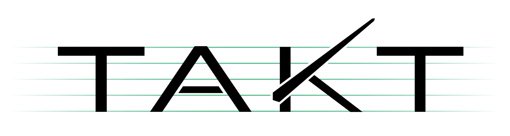
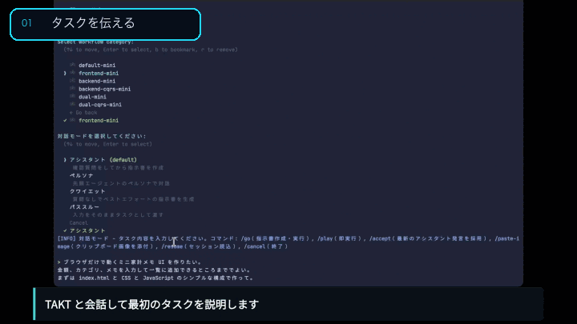
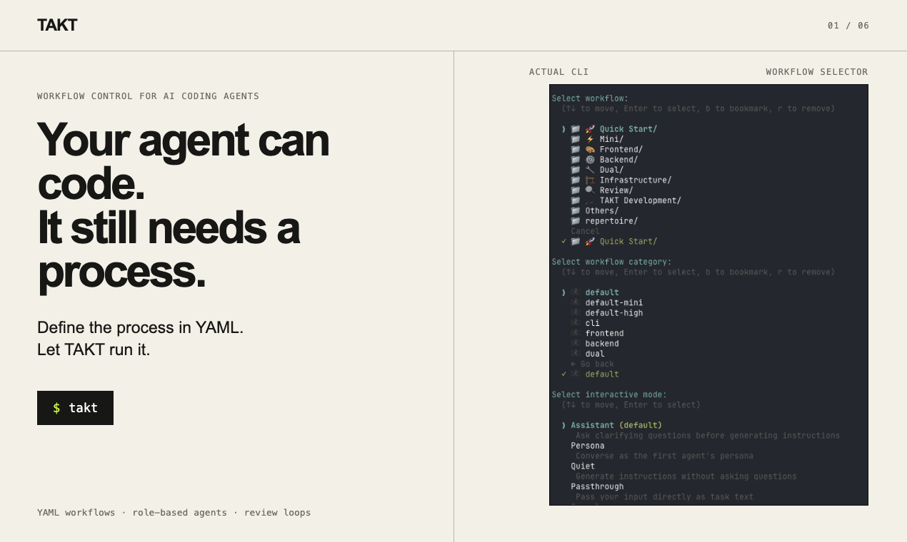

# TAKT

<p align="center">
  <picture>
    <source media="(prefers-color-scheme: dark)" srcset="./assets/takt-logo-dark.svg">
    
  </picture>
</p>

<p align="center">
  <a href="https://www.npmjs.com/package/takt"></a>
  <a href="https://github.com/nrslib/takt/stargazers"></a>
  <a href="https://github.com/nrslib/takt/actions/workflows/ci.yml"></a>
  <a href="../LICENSE"></a>
  <a href="https://discord.gg/R2Xz3uYWxD"></a>
</p>

<p align="center">
  <a href="../README.md">English</a> |
  <a href="./README.ja.md">日本語</a> |
  <a href="./README.zh-CN.md">简体中文</a>
</p>

<p align="center">
  <a href="https://nrslib.github.io/takt/#tutorial">
    
  </a>
</p>

**AI コーディングエージェントの見張り番をやめる。**

TAKT は AI コーディングエージェントの開発手順を定義し、繰り返し実行できる OSS CLI です。計画、実装、レビュー、修正ループ、人間への確認、権限、出力契約を YAML に記述します。タスクは隔離された worktree で実行され、作業の経緯をログで確認できます。

各 step のエージェントに役割、文脈、遷移ルールを与え、コードを書く作業から次の工程への移行までを workflow で管理します。



- 計画 → 実装 → レビュー → 修正ループを明示的な workflow step として実行
- step ごとに persona、policy、knowledge、instruction、output contract を分け、コンテキストを肥大化させない
- 積んだタスクを隔離された worktree で実行し、後からログとレポートを確認できる
- Claude Code、Claude SDK、Codex SDK、OpenCode SDK、Pi SDK、公式 DeepSeek Harness SDK、Cursor、GitHub Copilot CLI、Kiro を provider として利用できる

**T**AKT **A**gent **K**oordination **T**opology は複数の AI エージェントをレビューループ、プロンプト管理、step ごとの権限でオーケストレーションするツールです。

AI と会話してやりたいことを決め、タスクとして積み、`takt run` で実行します。YAML の workflow ファイルに従って計画・実装・レビュー・修正を繰り返し、各エージェントはそれぞれに割り当てられた役割・権限・文脈で作業します。

主な用途は AI によるコーディングです。ほかにも、複数の AI エージェントが協力するタスクや、レビュー・判定・フィードバックを繰り返して精度を高めたい作業に使えます。

TAKT は TAKT 自身で開発しています（ドッグフーディング）。

## なぜ TAKT か

AI コーディングエージェントに長い作業を任せると、指示を忘れたり、不要なコンテキストが蓄積したり、実装とレビューの役割が混ざったりします。人間が同じ指摘を何度も繰り返すこともあり、開発手順を安定して続けるのが難しくなります。

プロンプトや `CLAUDE.md`、スキルにルールを書き足せば指示を補えますが、手順を守るかどうかはエージェントの判断に委ねられます。

TAKT は workflow に定義した工程に従ってエージェントの作業を制御します。persona・policy・knowledge・instruction・output contract を step ごとに与え、実装、レビュー、修正、再レビューの順序や戻り先を指定できます。役割・知識・制約を分けて各 step に必要なものだけを渡し、コンテキストの肥大化を防ぎながらタスクの精度を高めます。

レビューを必須の工程にし、問題があれば修正へ戻し、必要に応じて人間に判断を求めます。タスクは隔離されたワークツリーで実行され、各 step の結果がログとレポートに残るため、タスクから PR までの経緯を後から確認できます。

役割、工程、判定、フィードバックループを定義した workflow は再利用でき、人間が付き添い続けなくても、開発手順を確認し、同じ手順で再実行できます。

## 5分で試す

少なくとも1回 commit 済みの Git リポジトリで実行します。

```bash
npm install -g takt

# 既定の provider(claude-sdk)の SDK をインストールします
takt install claude-sdk

# AI と会話し、タスクを説明し、/go の後に「タスクにつむ」を選びます
takt

# 積んだタスクを隔離された worktree で実行します
takt run

# diff の確認、マージ、リトライ、リキュー、タスクブランチ削除を行います
takt list
```

初回実行時は `~/.takt/config.yaml` で provider を設定するか、[設定](#設定) にある API キー用の環境変数を使います。SDK 経由 provider の `claude-sdk`、`codex`、`opencode`、`pi`、`deepseek-harness` は Node.js で動きます。使う前に一度 `takt install <provider>` を実行してください。CLI 経由 provider には対応する外部 CLI が必要です。

## CodeRabbit レビューループ

GitHub PR に対して `takt caccia <PR番号>` を実行すると、CodeRabbit のレビューを待ち、隔離クローンで未解決の bot スレッドに対応します。指摘への判断はループごとにレポートへ保存されます。

マージ用 workflow からは `caccia` 効果でこのループを実行します。効果が CodeRabbit を待つかどうかは `caccia.enabled` で設定でき、既定では無効です。有効にすると、worktree タスクの `auto_pr` と Pipeline の `--auto-pr` による PR 公開後にもループが実行されます。Git の push だけでは起動しません。除外条件や実行順序は[設定ガイド](./configuration.ja.md)、操作方法は[CLI リファレンス](./cli-reference.ja.md#takt-caccia)を参照してください。

### 動画チュートリアル

[文章版チュートリアル](./tutorial.ja.md)に沿って実際に操作する様子を次の動画で確認できます。

| Chapter 1 | Chapter 2 |
|-----------|-----------|
| [](https://youtu.be/H_L_slDJNqs) | [](https://youtu.be/cfM9USMkh2Y) |

## TAKT と通常の AI コーディングエージェントの違い

| 通常の AI コーディングエージェント | TAKT |
|------------------------------------|------|
| プロンプトでプロセスを守るよう依頼する | YAML workflow がプロセスを管理する |
| レビュー手順が忘れられたり飛ばされたりする | レビューと修正ループが明示的な遷移になる |
| 1つの長いコンテキストが肥大化し続ける | 各 step に必要なコンテキストだけを渡す |
| 実装とレビューの責務が混ざりやすい | persona、権限、output contract で責務を分ける |
| 作業がカレントツリーに直接入ることが多い | 積んだタスクはデフォルトで隔離された worktree で実行される |
| タスクから結果までの経路を追いにくい | ログとレポートでタスクから PR までの経路を追跡できる |
| 同じプロセスを記憶で再現する必要がある | workflow を再利用・レビュー・バージョン管理できる |

## 必要なもの

TAKT の実行には Node.js `>=22.22.0` と Git `>=2.38` が必要です。ゴールの完成判定には `git merge-tree --write-tree` による tree の比較を使います。

利用するプロバイダーに応じて、外部 CLI のインストール要否が変わります。

デフォルトは Claude Agent SDK を使う `claude-sdk` です。`claude` も `claude-sdk` のエイリアスとして動きます。

従来の Claude Code CLI を使う場合は provider に `claude-headless` を指定します。権限プロファイルは選択した provider 名へ移してください。既定の provider は `claude-sdk` に変わったため、旧 `provider_profiles.claude` の権限設定が適用されない場合があります。旧 `claude` 名の session は新しく開始されます。移行の詳細は[権限の解決順序](./configuration.ja.md#パーミッション解決の優先順位)を参照してください。

次のプロバイダーを使う場合は CLI 不要です（SDK 経由、Node.js のみで動作）。SDK は TAKT に同梱していないため、使う前に一度 `takt install <provider>` を実行し、TAKT を更新したら `takt update` を実行してください。端末では、SDK が無いとインストールするかを確認します。CI など対話できない実行では、事前にインストールしてください。詳しくは[管理SDKの導入と更新](./cli-reference.ja.md#管理sdkの導入と更新)を参照してください。

- `claude-sdk`: `@anthropic-ai/claude-agent-sdk`
- `codex`: `@openai/codex-sdk`
- `pi`: `@earendil-works/pi-coding-agent`

`deepseek-harness` は公式 TypeScript SDK と対応する runtime を使います。利用前に `takt install deepseek-harness` を実行してください。対応環境は glibc `>= 2.28` の Linux x64/arm64 と macOS arm64 `>= 14.0` です。runtime 終了後は session 履歴を復元できないため、新しい TAKT session/run を開始します。認証、利用できる tool、権限、旧環境からの移行と復旧手順は[設定ガイド](./configuration.ja.md#deepseek-harness-deepseek-harness)を参照してください。

次のプロバイダーには外部 CLI のインストールが必要です。

- `opencode`: [OpenCode](https://opencode.ai/) CLI。SDK 用に `takt install opencode` も必要です。既定は v2 です。v1 を使う場合は明示的に選択します（[移行設定](./configuration.ja.md#opencode-v1v2-の選択)）。
- `claude-headless`: [Claude Code](https://claude.ai/code)
- `claude-terminal`: [Claude Code](https://claude.ai/code) を対話型ターミナルセッションで動かします。[`tmux`](https://github.com/tmux/tmux) も必要です。
- `copilot`: [GitHub Copilot CLI](https://docs.github.com/en/copilot/github-copilot-in-the-cli)
- `cursor`: [Cursor Agent](https://docs.cursor.com/)
- `kiro`: [Kiro CLI](https://kiro.dev/docs/cli/headless/)
- `devin`: [Devin CLI](https://devin.ai/)

次のツールは、使う機能に応じてインストールしてください。

- [GitHub CLI](https://cli.github.com/) (`gh`): `takt #N` で GitHub Issue を使う場合に必要です。
- [GitLab CLI](https://gitlab.com/gitlab-org/cli) (`glab`): GitLab Issue/MR 連携に使います。リモート URL から自動検出されます。
- Java 17 以上: 形式仕様モードの `/verify` で `quint verify` と Alloy Analyzer によるモデル検査を実行する場合に必要です。`java` コマンドが `PATH` から見つかる必要があります。Quint 自体は TAKT に同梱されているため、別途インストールは不要です。初回実行時に自動でダウンロードされるものについては [形式仕様の検証](./formal-verification.ja.md) を参照してください。

> **OAuth の利用について:** OAuth が利用可能かどうかはプロバイダーや用途によって異なります。TAKT を利用する際には各プロバイダーの利用規約をご確認ください。

## クイックスタート

### インストール

```bash
npm install -g takt
takt install claude-sdk   # codex、opencode、pi、deepseek-harness も同様
```

Nix flakes でもインストールできます。

```bash
nix run github:nrslib/takt
nix profile install github:nrslib/takt
```

Nix パッケージがインストールするのは TAKT CLI 本体のみです。外部 CLI プロバイダー、`git`、`gh`/`glab` は、[必要なもの](#必要なもの) に記載のとおり別途インストールして `PATH` に置くか、設定で指定してください。

### AI と相談してタスクを積む

```
$ takt

Select workflow:
  > 🎼 default (current)
    📁 🚀 クイックスタート/
    📁 🛠️ 開発/
    📁 🔍 レビュー/

対話モード - タスク内容を入力してください。準備ができたら /go で指示書を作成・実行します。

> ユーザー認証を JWT で追加して

[AI が要件を整理してくれます]

> /go

提案されたタスク指示:
  ...

どうしますか？
  > タスクにつむ          # ← 通常フロー・初期選択
    Issueを建てる
    その場で実行する
    会話を続ける
```

「タスクにつむ」を選ぶと `.takt/tasks/` にタスクが保存されます。`takt run` を実行すると、隔離されたワークツリー上で計画 → 実装 → レビュー → 修正ループのワークフローが動きます。完了後に PR を作成するかどうかを選べます。

「Issueを建てる」を選ぶと、作成前に「タスクにつみますか？ [Y/n]」と確認されます。Y または Enter で Issue を作成し、タスクの保存と worktree の設定に進みます。n では Issue だけを作成し、Esc では何も作らず同じメニューへ戻ります。`--pr` のセッションには Issue の項目は表示されません。

通常の assistant 会話では `/issue 123` または `/issue 12 34` で参照する Issue を置き換え、同じ会話を続けられます。次の発言と `/go` には取得した Issue の内容が使われます。

```bash
# 積んだタスクを実行
takt run

# GitHub Issue からも積めます
takt add '#6'
takt add '#12'

# まとめて実行
takt run
```

> **「その場で実行する」を選んだ場合:** ワークフローが終わるまでこの TUI は使えなくなることと、通常はタスクにつんで `takt run` で実行することを案内します。確認の既定値は N（`[y/N]`）です。y でのみ既存の実行処理へ進み、ワークツリーを作らずカレントディレクトリで作業します。N・Enter・Esc では実行せず、選択位置を保持してメニューへ戻ります。メニューで Esc を押すと会話入力へ戻ります。

### 結果を管理する

```bash
# タスクブランチの一覧を確認し、マージ、リトライ、リキュー、停止依頼、強制失敗、削除ができます
takt list
```

**Stop** は実行中のタスク1件に停止を依頼し、worker が自分で中断して終端状態を決めます。**Mark as failed** は状態を付け直すだけで、worker を停止しません。

## 仕組み

TAKT という名前は、オーケストラの指揮で使う「拍」「指揮棒の一振り」を意味するドイツ語の「タクト（Takt）」に由来します。TAKT では、利用者向けの説明と実装の両方で **workflow** と **step** という呼び名を使います。

workflow は step の並びで構成されます。YAML では `steps`、`initial_step`、`max_steps` を使います。各 step では persona（誰が実行するか）、権限（何を許可するか）、ルール（次にどこへ進むか）を指定します。最小の例は次の通りです。

```yaml
name: plan-implement-review
initial_step: plan
max_steps: 10

steps:
  - name: plan
    persona: planner
    edit: false
    rules:
      - condition: Planning complete
        next: implement

  - name: implement
    persona: coder
    edit: true
    required_permission_mode: edit
    rules:
      - condition: Implementation complete
        next: review

  - name: review
    persona: reviewer
    edit: false
    rules:
      - condition: Approved
        next: COMPLETE
      - condition: Needs fix
        next: implement    # <- 修正ループ
```

ルールが次の step を決めます。`COMPLETE` でワークフロー成功終了、`ABORT` で失敗終了です。完全なスキーマ、並列 step、ルール条件の詳細は [Workflow Guide](./workflows.ja.md) を参照してください。

繰り返し使う step 定義は `.takt/steps/` に置き、workflow から `uses` で参照できます。探索順と上書き規則は [Workflow Guide](./workflows.ja.md) を参照してください。

workflow ファイルの正式ディレクトリ名は `workflows/` です。

同名 workflow が複数箇所にある場合の探索順は `.takt/workflows/` → `~/.takt/workflows/` → builtin です。

## おすすめワークフロー

| Workflow | 用途 |
|-------|------|
| `default` | 標準の開発 workflow。シナリオに基づく計画とテスト先行開発に、実装を補助する companion の動的な選択、複数の観点からの並列レビュー、指摘の裁定、問題が解消するまでの修正ループを組み合わせる。 |
| `maintenance` | 既存コードベース向けの `default` 派生。変更範囲外の仕様を維持し、依頼に関係する変更に絞って進める。 |
| `simple` | `pure` と同じ最小構造に、変更内容に応じて TAKT がドメインファセットを自動選択して注入する軽量 workflow。AI アンチパターンとアーキテクチャの指針は常に含む。 |
| `pure` | ドメインファセットを注入しない最小 workflow。モデル自身の判断と SKILL 選択を信頼する。 |
| `takt-default` | TAKT 自体の開発で実際に使われている workflow。CLI ツールの開発にそのまま活用できます。 |
| `takt-default-team` | 実装・修正を Team Leader のタスク分解で実行する `takt-default` の派生。 |
| `review` | 動的レビュワー選択と supervisor による統合を行う、コードを変更しない多観点レビュー。 |
| `review-fix` | 複数の観点からレビューする workflow。レビュワーを動的に選び、標準 workflow と同じ指摘の裁定、修正・検証のループ、要件の最終確認を行う。 |

ドメイン特化ファミリー（`simple-*` / `frontend` / `backend` / `dual` / CQRS / `*-mini` 系）は 📦 レガシーカテゴリで引き続き利用できます。

全ワークフロー・ペルソナの一覧は [Builtin Catalog](./builtin-catalog.ja.md) を参照してください。

## 主要コマンド

| コマンド | 説明 |
|---------|------|
| `takt` | AI と相談して、タスクを実行または積みます |
| `takt exec` | ワークフロー YAML を書かずにマルチエージェントを即座に実行します |
| `takt make` | Workflow Maker を起動し、対話で独立したワークフローバンドルを作成・修正します |
| `takt add` | AI と会話してタスクの要件を詰め、タスクを積みます（GitHub Issue からも可） |
| `takt run` | 積まれたタスクをまとめて実行します |
| `takt watch` | タスクキューを監視し、pending タスクを自動実行します（常駐プロセス） |
| `takt ui` | 実験的な Viewer 中心の Web UI を `http://127.0.0.1:20525` で起動します |
| `takt manager` | 実験的なゴール相談 TUI を起動し、AI と会話しながらタスクを投入・実行します。[ゴール管理](./goal-management.ja.md)を参照してください |
| `takt director` | 全 manager を見渡す実験的な会話 TUI を開きます。[director](#director実験的)を参照してください |
| `takt list` | タスクブランチを管理します（マージ、リトライ、リキュー、停止依頼、強制失敗、追加指示、削除） |
| `takt #N` | GitHub Issue を初期入力としてタスク化します |
| `takt merge` | workflow で PR のレビュー・修正・マージを行います |
| `takt install <provider>` | SDK 経由 provider の SDK をインストールします |
| `takt update` | インストール済みの provider SDK を TAKT が指定する固定バージョンに更新します |
| `takt eject` | ビルトインの workflow/facet をコピーしてカスタマイズできます |
| `takt workflow init` | カスタム workflow のひな形を作成します |
| `takt workflow doctor` | カスタム workflow の定義を静的検証します |
| `takt workflow inspect` | workflow の設定と、その設定を読み込んだ場所を検査します |
| `takt repertoire add` | GitHub から repertoire パッケージをインストールします |
| `takt daemon stop` | バックグラウンドの daemon を停止します |
| `takt caccia` | PR の CodeRabbit レビュースレッドに対応します |
| `takt resume` | 最後に失敗・中止した直接実行の run を再開します |
| `takt clear` | エージェントの会話セッションを消去します |
| `takt reset config` | バックアップを作り、グローバル設定をテンプレートに戻します |
| `takt reset categories` | ワークフローカテゴリを組み込みの状態に戻します |
| `takt prompt` | 各 step に渡すプロンプトをプレビューします |
| `takt export-cc` | workflow と agent を Claude Code のスキルとして出力します |
| `takt export-codex` | workflow と agent を Codex のスキルとして出力します |
| `takt catalog` | 利用できる facet を一覧表示します |
| `takt workflow bundle attach` | 過去のソースから作った workflow bundle を旧形式の run に関連付けます |
| `takt metrics review` | レビューの品質指標を表示します |
| `takt purge` | 古い分析イベントファイルを削除します |
| `takt telemetry status`、`takt telemetry enable`、`takt telemetry disable` | ローカルのルーティング記録を確認・変更します |
| `takt repertoire remove`、`takt repertoire list` | 導入済みの repertoire パッケージを削除・一覧表示します |

manager との会話は daemon で処理されるため、TUI を閉じても作業は続きます。同じリポジトリや workspace で開き直せば、同じ会話を続けられます。ゴールの登録、会話の再開、処理の中断については[ゴール管理](./goal-management.ja.md)を参照してください。daemon を止めるには `takt daemon stop` を使います。

manager に画像を貼り付けると、参照した画像は会話とともに保存されます。manager が保存済み画像のパスをタスクの指示に含めた場合、TAKT は画像をタスクの添付ファイルへコピーし、workflow から読めるようにします。終了したゴールは manager の実行中ゴールの文脈から外れますが、`Ctrl+G` で見つけて削除できます。

`config.yaml` の `manager.runtime_assignments` で、manager がタスクごとに選べる runtime assignment の候補を指定できます。名前は `runtime.yaml` の `provider.assignments` を参照し、リトライ・リキューでも選択を引き継ぎます。TUI の更新間隔は `manager.refresh_interval_ms` または `TAKT_MANAGER_REFRESH_INTERVAL_MS` で変更できます。詳しくは[ゴール管理](./goal-management.ja.md)と[設定ガイド](./configuration.ja.md)を参照してください。

manager は実験的機能で、動作・設定・保存データの形式は予告なく変わることがあります。タスクを自動で投入・実行するため、provider の API 費用がかかります。

**Slack での会話:** 設定した Slack チャンネルからも、同じ manager の会話につながります。返事は発言したスレッドにだけ届き、TUI の返事は Slack に転送しません。Socket Mode の App マニフェスト、トークン用環境変数、リポジトリ設定、問い合わせへの回答方法は、[Slack で manager と会話する](./configuration.ja.md#slack-で-manager-と会話する)を参照してください。完成などの通知は、別の経路である `TAKT_NOTIFY_WEBHOOK` の Incoming Webhook を引き続き使います。

全コマンド・オプションは [CLI Reference](./cli-reference.ja.md) を参照してください。

`takt list --non-interactive --action delete` の `--status <status...>` には、`pending`、`completed`、`failed`、`exceeded`、`pr_failed` を複数指定できます。実行中のタスクは削除できないため、`running` は指定できません。`--goal <goalId>` は指定ゴールに属するタスクに絞ります。既存の `--branch <branch>` も使用でき、単独指定では `completed` のタスクだけが対象です。

`--status`、`--goal`、`--branch` のいずれか1つ以上が必須です。無指定では何も削除せず、エラーで終了します。`--yes` を省略すると対象のタスク名・状態・ブランチ・ゴールの一覧を表示し、削除せず正常終了します。削除は `--yes` を指定した場合だけ行います。`--format json` を併せると対象一覧を JSON で取得でき、JSON 出力には `goal_id` が含まれます。

削除対象は対話型の一覧で削除する場合と同じです。タスクの作業用 clone、worktree セッションのファイル、clone のメタ情報、ブランチ、`.takt/tasks.yaml` の記録が対象です。clone タスクでは、元のリポジトリの同名ブランチも `git branch -d` による削除の対象になります。未取り込みなどの理由で Git が削除を拒否した場合は、そのブランチを残して警告し、clone とタスクの記録は削除します。ブランチが保持される条件などの詳細は[タスク管理](./task-management.ja.md)を参照してください。

```bash
# 対象一覧を確認してから削除します
takt list --non-interactive --action delete --status failed pr_failed
takt list --non-interactive --action delete --status failed pr_failed --yes

# 対象一覧を JSON で確認します
takt list --non-interactive --action delete --status failed pr_failed --format json
```

クライアント連携用のコマンドも 2 つ同梱しています。`takt-acp` は TAKT を stdio JSON-RPC の [Agent Client Protocol](./cli-reference.ja.md#acp-agent) エージェントとして起動します。`takt-mcp` は stdio の [MCP サーバー](./cli-reference.ja.md#mcp-server)として起動し、MCP クライアント（Codex、Claude Code など）からタスクの追加、タスクや実行の状態確認、実行中の worktree clone への追加指示ができます。pending タスクの実行には `takt run` または `takt watch` を使用します。

MCP の `takt_cleanup_tasks` では、対象一覧を確認してからタスクを削除できます。`takt_stop_goal_task` では、ほかのタスクやゴールを続けたまま、実行中のゴールタスク1件に停止を依頼できます。引数、削除範囲、停止・中断後の扱いは[タスク管理](./task-management.ja.md)と[ゴール管理](./goal-management.ja.md)を参照してください。

通常の `takt` assistant 会話でも、MCP 対応 provider なら同じ task 状態を読み取り専用で確認できます。新しいタスクは `/go`、実行中 worktree clone への追加指示は `/tell` で対象を選び、確認してから送ります。失敗したタスクは `/requeue` または `/retry` で、確認のうえキューに戻せます。

### manager の判断と作業

manager は担当のゴールを完成まで進めるため、自分で調査・実装・確認・Git 操作を行い、必要に応じて作業を委任します。provider の通常のツールと割り当てた MCP を使い、利用者の provider options を引き継ぎます。権限は既定で `auto` です。権限の変更方法や、タスクに使う workflow の選び方は[設定ガイド](./configuration.ja.md#manager-がタスクに使う-workflow)を参照してください。

マージ、force push、リモートブランチや未保存の成果物の削除などは、人の明示指示に従います。指示の扱い、秘密情報の保護、旧設定からの移行は[ゴール管理](./goal-management.ja.md)を参照してください。

### インスタント exec モード

`takt exec` は対話しながらタスクを作るモードです。Assistant エージェントと要件を詰め、`/go` で会話をワークフローに変換します。Worker エージェントが実装し、Review エージェントがレビューします。必要に応じて Replanning エージェントがユーザーに方針を確認し、進展のない繰り返しはループ検出で防ぎます。

exec は前回の設定から開始するか、初回実行時はデフォルト設定を使用します。プリセット名を渡すとそのプリセットから開始します。会話中に `/setup` でエージェント、ループ検出閾値、プリセット、参照ファセットを編集できます。`/go` を実行すると、TAKT は `.takt/exec/workflow.yaml` を生成し、通常のワークフローエンジンで実行します。`/cancel` で実行せずに終了します。入力行の編集中は画像添付（`/paste-image`、`Ctrl+V`、OSC 1337 インライン画像ペースト）が使えます。

プリセットの解決順序、`/setup` の保存先、画像の制限、`session_key` の挙動は [CLI Reference](./cli-reference.ja.md) の Instant Exec モードを参照してください。

## director（実験的）

対話端末で director と会話する TUI を開きます。

```bash
takt director
takt director --help
```

会話は daemon に保存されるため、TUI を閉じても、開き直せば続けられます。別の担当リポジトリから起動しても同じ会話につながりますが、前の画面の発言や返事は再表示されません。director は実験的機能で、動作や保存するデータの形式は予告なく変わることがあります。人の発言やイベントの処理では provider を呼び出すため費用がかかります。時刻だけをきっかけにモデルを呼び出すことはありません。

manager は担当するリポジトリまたは workspace のゴールを進め、タスクの投入、成果の取り込み、完成の申請を行います。director は manager のゴールと未回答の問い合わせを確認して人に知らせ、依頼から担当 manager を選びます。必要なら人が伝えた Git リポジトリの絶対パスに manager を用意し、人が1回確認する登録案を出します。任されたゴールの通常質問には答え、人の判断が必要な質問は直接人に届けます。マージの明示指示は担当 manager に転送し、マージは担当 manager が実行します。

担当選択、登録、Slack のボタン、質問の宛先、昇格と戻し、manager の解除（fire）、Slack の制限は[director の使い方](./director.ja.md)を参照してください。

`takt_tell_manager` で送った伝言は、manager が処理中でも保存されます。ツールは保存後すぐに操作 ID と宛先の manager を返し、manager の返事を待ちません。伝言は保存順に処理され、返事・失敗・中断の結果が同じ操作 ID とともに director の画面へ通知されます。manager 一覧を取得するときは、読み取れない project とその理由を表示し、ほかの manager の処理を続けます。

グローバルの `~/.takt/config.yaml` に `director.slack.channel_id` と `director.slack.allowed_user_ids` を設定します。詳しくは[グローバル設定フィールドリファレンス](./configuration.ja.md#グローバル設定フィールドリファレンス)を参照してください。

**director の Slack:** manager と同じ Slack App と `TAKT_SLACK_APP_TOKEN` / `TAKT_SLACK_BOT_TOKEN` を使い、ボットを director のチャンネルへ招待します。Slack 設定を変更したら daemon を起動し直してください。`director.slack` を設定すると、まとめた通知が届き、許可された人が会話できます。返事は元のスレッドに届きます。接続手順は[Slack で director と会話する](./configuration.ja.md#slack-で-director-と会話する)、詳しい役割と制限は[director の役割](./goal-management.ja.md#director-の役割)を参照してください。

## 設定

最小限の `~/.takt/config.yaml` は次の通りです。

```yaml
provider: claude-sdk    # claude-sdk, claude (alias), claude-headless, claude-terminal, codex, opencode, deepseek-harness, cursor, copilot, kiro, devin, pi, or mock
model: sonnet       # プロバイダーにそのまま渡されます
language: ja        # en or ja
```

実行のメタデータ、セッション、トレース、レポートなどは `.takt/runs/<run>/` 配下の通常ファイルとして保存されます。途中から再開する場合は、選択した位置に対応する保存結果とレポートを利用します。Requeue で先頭から再実行する場合は、過去の実行状態からは再開しません。引き継ぐ情報の詳細は[タスク管理](./task-management.ja.md)を参照してください。

ステップごとにプロバイダやモデルを選びたい場合は自動ルーティングを設定できます。選択結果を確認するには `takt telemetry enable` でローカル記録を有効にしてください。詳しい設定は[設定ガイド](./configuration.ja.md)を参照してください。

provider の認証情報を直接使う場合、Claude SDK、Codex、Pi に外部 CLI のインストールは不要です。SDK 経由 provider には `takt install <provider>` が必要で、OpenCode は外部 CLI も必要です。

```bash
export TAKT_ANTHROPIC_API_KEY=sk-ant-...   # Anthropic (Claude)
export TAKT_OPENAI_API_KEY=sk-...          # OpenAI (Codex)
export TAKT_OPENCODE_API_KEY=...           # OpenCode
export TAKT_CURSOR_API_KEY=...             # Cursor Agent（login 済みなら省略可）
export TAKT_COPILOT_GITHUB_TOKEN=ghp_...   # GitHub Copilot CLI
export TAKT_KIRO_API_KEY=...               # Kiro CLI
export DEEPSEEK_API_KEY=...                 # 公式 DeepSeek Harness SDK
# 任意: export DEEPSEEK_BASE_URL=https://...
# Pi は SDK の credential store または provider-native 環境変数を使用
```

OpenCode は、provider からイベントが届かない状態が既定で 60 分続くとタイムアウトします。イベントを受け取るたびにタイマーがリセットされるため、イベントが届き続ける限り 60 分を超えて実行できます。上限は `provider_options.opencode.guards.call_timeout_ms`（最大 86,400,000 ms）で変更できます。guard プロファイルとモデル別の上書き設定は [Configuration Guide](./configuration.ja.md) を参照してください。

`provider_options.claude.permissions.deny` を使うと、Claude Code の `permissions.deny` ルール（例: `Read(./.env)`）を `claude-sdk` と `claude-headless` に渡せます。
`Read(` ルールが止めるのは、Claude の組み込みのファイルツール（Grep や Glob などには `Read` ルールをベストエフォートで適用します）と、Claude Code が Bash の中で認識するファイル用コマンド（`cat`、`head` など）です。
ファイル名を書かずにファイルを読むコマンド（`grep -r pattern .` など）や、スクリプトが自分でファイルを開く読み取りは止められません。
Claude が sandbox 内で実行するシェルのコマンドと、そこから起動したプロセスによるパスへのアクセスを OS のレベルで止めるには、そのパスの `Read(` 拒否ルールを追加し、Claude Code の sandbox をファイルシステム隔離付きで有効にしてください。`sandbox.filesystem.disabled: true` は隔離を無効にし、sandbox 内のコマンドがホスト上のファイルを読めるため設定しないでください。`excludedCommands` に一致するコマンドや `allow_unsandboxed_commands` により sandbox 外で実行されるコマンドは、この遮断の対象外です。
拒否ルールのないパスは、sandbox の中のプロセスでも読めます。
hooks や MCP サーバーなど、sandbox の外で動くプロセスは止まりません。
`provider_options.claude.permissions.import_user_read_deny: true` を指定すると、`~/.claude/settings.json` の `Read(` ルールも取り込みます。
どちらのキーも既定では未指定で、`claude-terminal` は対象外です。
詳しくは[Claude Code の Read 拒否ルール](./configuration.ja.md#claude-read-deny-rules)を参照してください。

### プロバイダー設定専用レイヤー（`runtime.yaml`）

プロバイダ、モデル、ルーティングは `~/.takt/runtime.yaml` または `<project>/.takt/runtime.yaml` にまとめて設定できます。プロジェクト側の設定が優先されます。ワークフローの定義と実行環境の設定を分けたい場合に使ってください。`runtime.yaml` を使う場合は旧来のプロバイダ設定と混在させず、移行方法を[設定ガイド](./configuration.ja.md)で確認してください。

Codex と OpenCode のプロファイルでは、`context_window: auto`、固定の正の整数、`{ initial: 500000, auto_expand: true }` を指定できます。自動選定と拡張には確認済みのモデル上限を使い、`auto` で上限を確認できないときは provider の既定値を維持します。数値を指定すると容量を固定できます。詳しくは[設定ガイド](./configuration.ja.md)を参照してください。

companion reviewer は既定で無効です。有効にするには `runtime.yaml` のトップレベルに `companion.enabled: true` を設定します。グローバルとプロジェクトの両方に設定した場合は、両方が `true` のときだけ有効になります。グローバルで `false` に設定されている場合、プロジェクト側で `true` にしても有効になりません。

全設定項目・プロバイダープロファイル・モデル解決の詳細は [Configuration Guide](./configuration.ja.md) を参照してください。

## カスタマイズ

### カスタム workflow

```bash
takt workflow init my-flow   # カスタム workflow のひな形を作成
takt workflow doctor my-flow # workflow 定義を静的検証
takt eject default           # ビルトイン workflow を ~/.takt/workflows/ にコピーして編集
```

### カスタム persona

`~/.takt/facets/personas/` に Markdown ファイルを置きます。

```markdown
# ~/.takt/facets/personas/my-reviewer.md
You are a code reviewer specialized in security.
```

workflow から `persona: my-reviewer` で参照できます。

`~/.takt/personas/` も互換パスとして動作しますが、`takt catalog` が走査するのは `facets/` 配下だけです。

詳細は [Workflow Guide](./workflows.ja.md) を参照してください。ビルトインの persona 一覧は [Builtin Catalog](./builtin-catalog.ja.md) にあります。

## CI/CD

GitHub Actions 向けに [takt-action](https://github.com/nrslib/takt-action) を提供しています。

```yaml
- uses: nrslib/takt-action@main
  with:
    anthropic_api_key: ${{ secrets.TAKT_ANTHROPIC_API_KEY }}
    github_token: ${{ secrets.GITHUB_TOKEN }}
```

他の CI ではパイプラインモードを使います。

```bash
takt --pipeline --task "バグを修正して" --auto-pr
```

セットアップの詳細は [CI/CD Guide](./ci-cd.ja.md) を参照してください。

## プロジェクト構造

```
~/.takt/                    # グローバル設定
├── config.yaml             # プロバイダー、モデル、言語など
├── workflows/              # ユーザー定義の workflow
├── facets/                 # ユーザー定義のファセット（personas, policies, knowledge など）
└── repertoire/             # インストール済み repertoire パッケージ

.takt/                      # プロジェクトレベル
├── config.yaml             # プロジェクト設定
├── workflows/              # プロジェクト定義の workflow
├── facets/                 # プロジェクトのファセット
├── tasks.yaml              # 積まれたタスク
├── tasks/                  # タスクの仕様書
└── runs/                   # 実行レポート、ログ、コンテキスト
```

workflow 定義は `workflows/` 配下に配置します。

## Spec-Driven Development を採用する場合

TAKT の workflow では、成果物の出力契約やレビュー手順を使って仕様駆動開発（SDD）の工程を表現できます。

コミュニティの [j5ik2o/takt-sdd](https://github.com/j5ik2o/takt-sdd) は、要件定義から実装・検証までの workflow と facet を提供します。Claude と Codex に対応し、次のコマンドで導入できます。

```bash
npm install -g takt-sdd
```

コミュニティの他の統合は [External Integrations](./external-integrations.ja.md) を参照してください。

## ドキュメント

| ドキュメント | 内容 |
|-------------|------|
| [チュートリアル](./tutorial.ja.md) | 3 フェーズで題材を改良しながら、タスクを積み、実行し、結果を確認する流れ |
| [CLI Reference](./cli-reference.ja.md) | 全コマンド・オプション |
| [Configuration](./configuration.ja.md) | グローバル設定・プロジェクト設定 |
| [Observability](./observability.ja.md) | phase ごとの使用量イベントと集計 workflow |
| [Workflow Guide](./workflows.ja.md) | workflow の作成・カスタマイズ |
| [Builtin Catalog](./builtin-catalog.ja.md) | ビルトイン workflow・persona の一覧 |
| [Faceted Prompting](./faceted-prompting.ja.md) | プロンプト設計の方法論 |
| [Token Saving](./token-saving.ja.md) | トークン消費の計測と節約 |
| [形式仕様の検証](./formal-verification.ja.md) | `/verify` で合意した要件を Quint と Alloy で検証する |
| [Repertoire Packages](./repertoire.ja.md) | パッケージのインストール・共有 |
| [Task Management](./task-management.ja.md) | タスクの追加・実行・隔離 |
| [CI/CD Integration](./ci-cd.ja.md) | GitHub Actions・パイプラインモード |
| [External Integrations](./external-integrations.ja.md) | TAKT コアを変更せずに機能を拡張するコミュニティサンプル（監査ログ等） |
| [Changelog](../CHANGELOG.md) ([日本語](./CHANGELOG.ja.md)) | バージョン履歴 |

## スポンサー

TAKT は [CodeRabbit](https://coderabbit.link/nrslib) の Open Source Support Program によってサポートされています。

<a href="https://coderabbit.link/nrslib">
  <picture>
    <source media="(prefers-color-scheme: dark)" srcset="https://victorious-bubble-f69a016683.media.strapiapp.com/White_Typemark_79b9189d19.svg">
    <source media="(prefers-color-scheme: light)" srcset="https://victorious-bubble-f69a016683.media.strapiapp.com/Orange_Typemark_43bf516c9d.svg">
    
  </picture>
</a>

## コミュニティ

質問・議論・最新情報は [TAKT Discord](https://discord.gg/R2Xz3uYWxD) へどうぞ。

## コントリビュート

Issue とあわせた PR の提出を特に歓迎します。バグ修正や小さな改善は、メンテナーの返信や議論の完了を待たずに PR を提出していただいて構いません。

大規模なリファクタリングや、プロジェクトの設計・互換性に影響する機能追加は、手戻りを避けるため、実装前に Issue で方針を相談することをおすすめします。

[CONTRIBUTING.ja.md](./CONTRIBUTING.ja.md)（[English](../CONTRIBUTING.md)）を参照してください。

## ライセンス

MIT ライセンスです。[LICENSE](../LICENSE) を参照してください。
