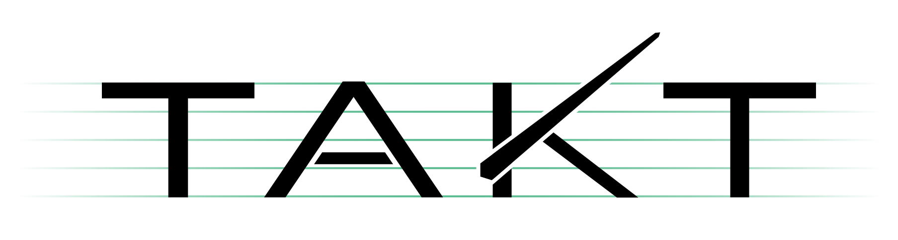
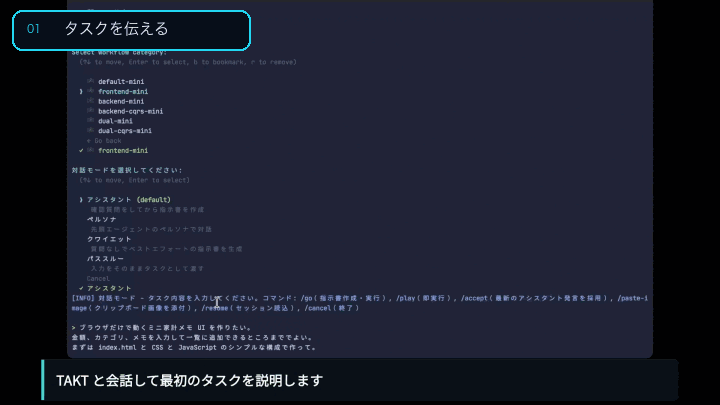
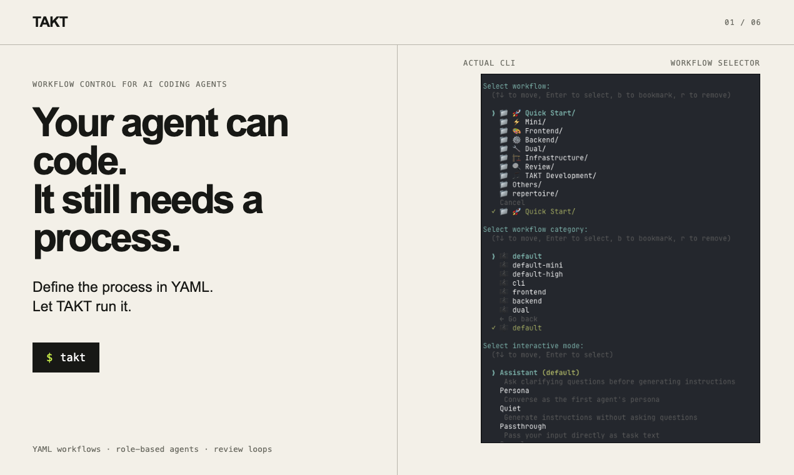

# TAKT

<p align="center">
  <picture>
    <source media="(prefers-color-scheme: dark)" srcset="./assets/takt-logo-dark.svg">
    
  </picture>
</p>

<p align="center">
  <a href="https://www.npmjs.com/package/takt"></a>
  <a href="https://github.com/nrslib/takt/stargazers"></a>
  <a href="https://github.com/nrslib/takt/actions/workflows/ci.yml"></a>
  <a href="../LICENSE"></a>
  <a href="https://discord.gg/R2Xz3uYWxD"></a>
</p>

<p align="center">
  <a href="../README.md">English</a> |
  <a href="./README.ja.md">日本語</a> |
  <a href="./README.zh-CN.md">简体中文</a>
</p>

<p align="center">
  <a href="https://nrslib.github.io/takt/#tutorial">
    
  </a>
</p>

**AI コーディングエージェントの見張り番をやめる。**

TAKT は AI コーディングエージェントを再現可能な開発ワークフローとして動かす OSS CLI です。計画、実装、レビュー、修正ループ、人間への確認、権限、出力契約を YAML で定義し、隔離された worktree と追跡可能なログ付きでタスクを実行します。

1つのエージェントにプロセス全体を覚えさせるのではなく、TAKT は step ごとに役割、文脈、遷移ルールを与えます。AI はコードを書きますが、次に何をするかは workflow が決めます。



- 計画 → 実装 → レビュー → 修正ループを明示的な workflow step として実行
- step ごとに persona、policy、knowledge、instruction、output contract を分け、コンテキストを肥大化させない
- 積んだタスクを隔離された worktree で実行し、後からログとレポートを確認できる
- Claude Code、Claude SDK、Codex SDK、OpenCode SDK、Pi SDK、公式 DeepSeek Harness SDK、Cursor、GitHub Copilot CLI、Kiro を provider として利用できる

**T**AKT **A**gent **K**oordination **T**opology は複数の AI エージェントをレビューループ、プロンプト管理、step ごとの権限でオーケストレーションするツールです。

AI と会話してやりたいことを決め、タスクとして積み、`takt run` で実行します。計画・実装・レビュー・修正のループは YAML の workflow ファイルで定義されており、エージェント任せにはしません。TAKT は Claude Code、Codex、OpenCode、Pi、公式 DeepSeek Harness SDK、Cursor、GitHub Copilot CLI、Kiro CLI を役割・権限・文脈の異なるエージェントとして協調させます。

TAKT は AI コーディングワークフローを主な用途として提供していますが、コーディング以外でも複数の AI エージェントを協調させたいタスクや、レビュー・判定・フィードバックループによってタスクの精度を高めたい場面で活用できます。

TAKT は TAKT 自身で開発しています（ドッグフーディング）。

## なぜ TAKT か

AI コーディングエージェントはそのままでは安定した開発プロセスにはなりません。長い作業では指示を忘れ、コンテキストが汚染され、実装とレビューの責務が混ざり、同じ指摘を人間が何度も繰り返すことにもなります。

プロンプトや `CLAUDE.md` やスキルにルールを書き足すことは助けになります。しかし、それだけではプロセスを強制できません。AI が守るかどうかを AI 自身の振る舞いに委ねることになるからです。

TAKT は AI エージェントをただ信頼するのではなく、外側から制御する対象として扱います。

workflow で工程を定義し、persona・policy・knowledge・instruction・output contract を step ごとに与え、実装、レビュー、修正、再レビューの流れを宣言的に管理します。責務・知識・制約を分け、必要な step の必要なエージェントにだけ渡すことで、コンテキストを肥大化させずにタスクの精度を高めます。

レビューを飛ばせない構造にし、問題があれば修正へ戻し、必要なら人間に判断を戻します。タスクはワークツリーで隔離され、各 step の結果はログとレポートに残るため、タスクから PR までの流れを後から追跡できます。

TAKT はこれらを役割、工程、判定、フィードバックループからなる再利用可能なエージェントプロセスとして動かします。人間の継続的な介入に依存せず、開発プロセスをレビュー可能で再現可能な仕組みに保ちます。

## 5分で試す

少なくとも1回 commit 済みの Git リポジトリで実行します。

```bash
npm install -g takt

# 既定の provider(claude-sdk)の SDK をインストールします
takt install claude-sdk

# AI と会話し、タスクを説明し、/go の後に「タスクにつむ」を選びます
takt

# 積んだタスクを隔離された worktree で実行します
takt run

# diff の確認、マージ、リトライ、リキュー、タスクブランチ削除を行います
takt list
```

初回実行時は `~/.takt/config.yaml` で provider を設定するか、[設定](#設定) にある API キー用の環境変数を使います。SDK 経由 provider の `claude-sdk`、`codex`、`opencode`、`pi`、`deepseek-harness` は Node.js で動きます。使う前に一度 `takt install <provider>` を実行してください。CLI 経由 provider には対応する外部 CLI が必要です。

## CodeRabbit レビューループ

GitHub PR に対して `takt caccia <PR番号>` を実行すると、CodeRabbit のレビューを待ち、隔離クローンで未解決の bot スレッドに対応し、反復ごとの判断レポートを保存します。マージ用 workflow は明示的な `caccia` 効果で同じループを実行します。`caccia.enabled` は効果が CodeRabbit を待つかを制御し、既定は無効です。push や PR 公開からの暗黙の実行はありません。[CLI リファレンス](./cli-reference.ja.md#takt-caccia)と[設定ガイド](./configuration.ja.md)を参照してください。

### 動画チュートリアル

[文章版チュートリアル](./tutorial.ja.md)に沿って実際に操作する様子を次の動画で確認できます。

| Chapter 1 | Chapter 2 |
|-----------|-----------|
| [](https://youtu.be/H_L_slDJNqs) | [](https://youtu.be/cfM9USMkh2Y) |

## TAKT と通常の AI コーディングエージェントの違い

| 通常の AI コーディングエージェント | TAKT |
|------------------------------------|------|
| プロンプトでプロセスを守るよう依頼する | YAML workflow がプロセスを管理する |
| レビュー手順が忘れられたり飛ばされたりする | レビューと修正ループが明示的な遷移になる |
| 1つの長いコンテキストが肥大化し続ける | 各 step に必要なコンテキストだけを渡す |
| 実装とレビューの責務が混ざりやすい | persona、権限、output contract で責務を分ける |
| 作業がカレントツリーに直接入ることが多い | 積んだタスクはデフォルトで隔離された worktree で実行される |
| タスクから結果までの経路を追いにくい | ログとレポートでタスクから PR までの経路を追跡できる |
| 同じプロセスを記憶で再現する必要がある | workflow を再利用・レビュー・バージョン管理できる |

## 必要なもの

TAKT の実行には Node.js `>=22.22.0` が必要です。

利用するプロバイダーに応じて、外部 CLI のインストール要否が変わります。

デフォルトは Claude Agent SDK を使う `claude-sdk` です。`claude` も `claude-sdk` のエイリアスとして動きます。

従来の Claude Code CLI を使う場合は provider に `claude-headless` を指定します。権限プロファイルは選択した provider 名へ移してください。既定の provider は `claude-sdk` に変わったため、旧 `provider_profiles.claude` の権限設定が適用されない場合があります。旧 `claude` 名の session は新しく開始されます。移行の詳細は[権限の解決順序](./configuration.ja.md#パーミッション解決の優先順位)を参照してください。

次のプロバイダーを使う場合は CLI 不要です（SDK 経由、Node.js のみで動作）。SDK は TAKT に同梱していないため、使う前に一度 `takt install <provider>` を実行し、TAKT を更新したら `takt update` を実行してください。端末では、SDK が無いとインストールするかを確認します。CI など対話できない実行では、事前にインストールしてください。詳しくは[管理SDKの導入と更新](./cli-reference.ja.md#管理sdkの導入と更新)を参照してください。

- `claude-sdk` — `@anthropic-ai/claude-agent-sdk`
- `codex` — `@openai/codex-sdk`
- `pi` — `@earendil-works/pi-coding-agent`

`deepseek-harness` は公式 TypeScript SDK と対応する runtime を使います。利用前に `takt install deepseek-harness` を実行してください。対応環境は glibc `>= 2.28` の Linux x64/arm64 と macOS arm64 `>= 14.0` です。runtime 終了後は session 履歴を復元できないため、新しい TAKT session/run を開始します。認証、利用できる tool、権限、旧環境からの移行と復旧手順は[設定ガイド](./configuration.ja.md#deepseek-harness-deepseek-harness)を参照してください。

次のプロバイダーを使う場合は外部 CLI のインストールが必要です:

- `opencode` — [OpenCode](https://opencode.ai/) CLI。SDK 用に `takt install opencode` も必要です。既定は v2、v1 は明示選択（[移行設定](./configuration.ja.md#opencode-v1v2-の選択)）。
- `claude-headless` — [Claude Code](https://claude.ai/code)
- `claude-terminal` — [Claude Code](https://claude.ai/code) を対話型ターミナルセッションで駆動（[`tmux`](https://github.com/tmux/tmux) も必要）
- `copilot` — [GitHub Copilot CLI](https://docs.github.com/en/copilot/github-copilot-in-the-cli)
- `cursor` — [Cursor Agent](https://docs.cursor.com/)
- `kiro` — [Kiro CLI](https://kiro.dev/docs/cli/headless/)

任意:

- [GitHub CLI](https://cli.github.com/) (`gh`) — `takt #N` で GitHub Issue を使う場合に必要です
- [GitLab CLI](https://gitlab.com/gitlab-org/cli) (`glab`) — GitLab Issue/MR 連携に使います（リモート URL から自動検出）
- Java 17 以上（`java` コマンドが `PATH` にあること） — 形式仕様モードの `/verify` で `quint verify` と Alloy Analyzer によるモデル検査を実行する場合に必要です。Quint 自体は TAKT に同梱されているため、別途インストールは不要です。初回実行時に自動でダウンロードされるものについては [形式仕様の検証](./formal-verification.ja.md) を参照してください

> **OAuth の利用について:** OAuth が利用可能かどうかはプロバイダーや用途によって異なります。TAKT を利用する際には各プロバイダーの利用規約をご確認ください。

## クイックスタート

### インストール

```bash
npm install -g takt
takt install claude-sdk   # codex、opencode、pi、deepseek-harness も同様
```

Nix flakes を使う場合:

```bash
nix run github:nrslib/takt
nix profile install github:nrslib/takt
```

Nix パッケージがインストールするのは TAKT CLI 本体のみです。外部 CLI プロバイダー、`git`、`gh`/`glab` は、[必要なもの](#必要なもの) に記載のとおり別途インストールして `PATH` に置くか、設定で指定してください。

### AI と相談してタスクを積む

```
$ takt

Select workflow:
  > 🎼 default (current)
    📁 🚀 クイックスタート/
    📁 🛠️ 開発/
    📁 🔍 レビュー/

対話モード - タスク内容を入力してください。準備ができたら /go で指示書を作成・実行します。

> ユーザー認証を JWT で追加して

[AI が要件を整理してくれます]

> /go

提案されたタスク指示:
  ...

どうしますか？
  > タスクにつむ          # ← 通常フロー・初期選択
    Issueを建てる
    その場で実行する
    会話を続ける
```

「タスクにつむ」を選ぶと `.takt/tasks/` にタスクが保存されます。`takt run` で実行すると、隔離されたワークツリー上でワークフロー（計画 → 実装 → レビュー → 修正ループ）が走り、終わったら PR を作成するか聞いてきます。

「Issueを建てる」を選ぶと、作成前に「タスクにつみますか？ [Y/n]」と確認されます。Y または Enter で Issue を作成し、既存のタスク保存と worktree 設定へ進みます。n では Issue だけを作成します。Esc では何も作らず同じメニューへ戻ります。`--pr` のセッションには Issue の項目は表示されません。

通常の assistant 会話では `/issue 123` または `/issue 12 34` で参照する Issue を置き換え、同じ会話を続けられます。次の発言と `/go` には取得した Issue の内容が使われます。

```bash
# 積んだタスクを実行
takt run

# GitHub Issue からも積めます
takt add '#6'
takt add '#12'

# まとめて実行
takt run
```

> **「その場で実行する」を選んだ場合:** ワークフローが終わるまでこの TUI は使えなくなることと、通常はタスクにつんで `takt run` で実行することを案内します。確認の既定値は N（`[y/N]`）です。y でのみ既存の実行処理へ進み、ワークツリーを作らずカレントディレクトリで作業します。N・Enter・Esc では実行せず、選択位置を保持してメニューへ戻ります。メニューで Esc を押すと会話入力へ戻ります。

### 結果を管理する

```bash
# タスクブランチの一覧を確認し、マージ、リトライ、リキュー、停止依頼、強制失敗、削除ができます
takt list
```

**Stop** は実行中のタスク1件に停止を依頼し、worker が自分で中断して終端状態を決めます。**Mark as failed** は状態を付け直すだけで、worker を停止しません。

## 仕組み

TAKT という名前はオーケストラの指揮で拍を刻むために使われる「拍」「指揮棒の一振り」を意味するドイツ語の「タクト（Takt）」に由来しています。TAKT はユーザー向けにも実装名にも **workflow** と **step** を使います。

workflow は step の並びで構成されます。YAML では `steps`、`initial_step`、`max_steps` を使います。各 step では persona（誰が実行するか）、権限（何を許可するか）、ルール（次にどこへ進むか）を指定します。最小の例は次の通りです。

```yaml
name: plan-implement-review
initial_step: plan
max_steps: 10

steps:
  - name: plan
    persona: planner
    edit: false
    rules:
      - condition: Planning complete
        next: implement

  - name: implement
    persona: coder
    edit: true
    required_permission_mode: edit
    rules:
      - condition: Implementation complete
        next: review

  - name: review
    persona: reviewer
    edit: false
    rules:
      - condition: Approved
        next: COMPLETE
      - condition: Needs fix
        next: implement    # <- 修正ループ
```

ルールが次の step を決めます。`COMPLETE` でワークフロー成功終了、`ABORT` で失敗終了です。完全なスキーマ、並列 step、ルール条件の詳細は [Workflow Guide](./workflows.ja.md) を参照してください。

繰り返し使う step 定義は `.takt/steps/` に置き、workflow から `uses` で参照できます。探索順と上書き規則は [Workflow Guide](./workflows.ja.md) を参照してください。

workflow ファイルの正式ディレクトリ名は `workflows/` です。

同名 workflow が複数箇所にある場合の探索順は `.takt/workflows/` → `~/.takt/workflows/` → builtin です。

## おすすめワークフロー

| Workflow | 用途 |
|-------|------|
| `default` | 標準の開発 workflow。シナリオベースの計画とテスト先行開発に、動的実装 companion、多観点並列ピアレビュー、裁定、収束型 fix ループを組み合わせた構成。 |
| `maintenance` | 既存コードベース向けの `default` 派生。変更範囲外の契約を保存し、因果関係のある差分に限定して進める。 |
| `simple` | `pure` と同じ最小構造に、変更内容に応じて TAKT がドメインファセットを自動選択して注入する軽量 workflow。AI アンチパターンとアーキテクチャの指針は常に含む。 |
| `pure` | ドメインファセットを注入しない最小 workflow。モデル自身の判断と SKILL 選択を信頼する。 |
| `takt-default` | TAKT 自体の開発で実際に使われている workflow。CLI ツールの開発にそのまま活用できます。 |
| `takt-default-team` | 実装・修正を Team Leader のタスク分解で実行する `takt-default` の派生。 |
| `review` | 動的レビュワー選択と supervisor による統合を行う、コードを変更しない多観点レビュー。 |
| `review-fix` | 動的レビュワー選択の後、標準 workflow と同じ裁定・検証付き修正ループと要件の最終確認で収束させる多観点レビュー。 |

ドメイン特化ファミリー（`simple-*` / `frontend` / `backend` / `dual` / CQRS / `*-mini` 系）は 📦 レガシーカテゴリで引き続き利用できます。

全ワークフロー・ペルソナの一覧は [Builtin Catalog](./builtin-catalog.ja.md) を参照してください。

## 主要コマンド

| コマンド | 説明 |
|---------|------|
| `takt` | AI と相談して、タスクを実行または積みます |
| `takt exec` | ワークフロー YAML を書かずにマルチエージェントを即座に実行します |
| `takt make` | Workflow Maker を起動し、対話で独立したワークフローバンドルを作成・修正します |
| `takt add` | AI と会話してタスク要件を精緻化し、タスクを積みます（GitHub Issue からも可） |
| `takt run` | 積まれたタスクをまとめて実行します |
| `takt watch` | タスクキューを監視し、pending タスクを自動実行します（常駐プロセス） |
| `takt ui` | 実験的な Viewer 中心の Web UI を `http://127.0.0.1:20525` で起動します |
| `takt manager` | 実験的なゴール相談 TUI を起動します。引数なしの `/go` で現在の会話から要約を依頼し、要約があれば作り直さずに承認・登録します。動作・設定・保存するデータの形式は予告なく変わることがあります。自動でタスクを投入・実行するため、provider の API の費用がかかります。claude（claude-sdk）または codex では、道具の実行前に AI が審査します。起動時に daemon が自動で起動し、イベント処理と巡回を行います。`takt daemon stop` で daemon を停止できます |
| `takt list` | タスクブランチを管理します（マージ、リトライ、リキュー、停止依頼、強制失敗、追加指示、削除） |
| `takt #N` | GitHub Issue を初期入力としてタスク化します |
| `takt merge` | workflow で PR のレビュー・修正・マージを行います |
| `takt install <provider>` | SDK 経由 provider の SDK をインストールします |
| `takt update` | インストール済みの provider SDK を TAKT が固定した版に更新します |
| `takt eject` | ビルトインの workflow/facet をコピーしてカスタマイズできます |
| `takt workflow init` | カスタム workflow のひな形を作成します |
| `takt workflow doctor` | カスタム workflow の定義を静的検証します |
| `takt workflow inspect` | workflow の設定と解決ソースを検査します |
| `takt repertoire add` | GitHub から repertoire パッケージをインストールします |

全コマンド・オプションは [CLI Reference](./cli-reference.ja.md) を参照してください。

`takt list --non-interactive --action delete` の `--status <status...>` には、`pending`、`completed`、`failed`、`exceeded`、`pr_failed` を複数指定できます。実行中のタスクは削除できないため、`running` は指定できません。`--goal <goalId>` は指定ゴールに属するタスクに絞ります。既存の `--branch <branch>` も使用でき、単独指定では `completed` のタスクだけが対象です。

`--status`、`--goal`、`--branch` のいずれか1つ以上が必須です。無指定では何も削除せず、エラーで終了します。`--yes` を省略すると対象のタスク名・状態・ブランチ・ゴールの一覧を表示し、削除せず正常終了します。削除は `--yes` を指定した場合だけ行います。`--format json` を併せると対象一覧を JSON で取得でき、JSON 出力には `goal_id` が含まれます。

削除する範囲は対話の一覧からの削除と同じで、タスクの作業場所の clone、worktree セッションのファイル、clone のメタ情報、ブランチ、`.takt/tasks.yaml` の記録です。

```bash
# 対象一覧を確認してから削除します
takt list --non-interactive --action delete --status failed pr_failed
takt list --non-interactive --action delete --status failed pr_failed --yes

# 対象一覧を JSON で確認します
takt list --non-interactive --action delete --status failed pr_failed --format json
```

クライアント連携用のエントリポイントも 2 つ同梱しています。`takt-acp` は TAKT を stdio JSON-RPC 上の [Agent Client Protocol](./cli-reference.ja.md#acp-agent) エージェントとして起動し、`takt-mcp` は stdio の [MCP サーバー](./cli-reference.ja.md#mcp-server) として起動して、MCP クライアント（Codex、Claude Code など）からタスクを積み、task/run 状態を確認し、実行中 worktree clone へ追加指示を送れます。pending タスクの実行には `takt run` または `takt watch` を使用します。

`takt_cleanup_tasks` は絞り込んだタスクの一覧を確認してから削除するツールです。絶対パスの `cwd` と `reason` が必須です。任意入力は `statuses`（`pending`、`completed`、`failed`、`exceeded`、`pr_failed` を複数指定でき、`running` は指定できません）、`goalId`、`branch`、`confirm`（既定値は `false`）です。`statuses`、`goalId`、`branch` のいずれか1つ以上が必要です。

`confirm` の省略時または `false` の場合は対象一覧だけを返し、何も削除しません。`confirm: true` の場合だけ、`takt list` と同じ範囲を削除します。このツールは `all` のツール一覧だけで利用でき、`read-only` と `manager` には含まれません。`manager` には別のツール `takt_remove_goal_task` があります。

`takt_stop_goal_task` は `manager` と `all` のツール一覧で利用できます。絶対パスの `cwd` を渡します。`takt_list_tasks` が返す同じタスク項目の `name` の値を `taskName` に設定し、`goalId`・`executionId` もその項目の値を使います。所有PIDの生存を確認します。開始時刻が保存されている場合は、現在の開始時刻を取得して一致を確認します。保存済み開始時刻がない場合は、goalId・taskName・executionIdの一致、実行中の状態、所有PIDの生存を確認して受理します。識別情報の不一致、実行中でないタスク、所有プロセスの終了は、停止依頼を保存せず理由付きで拒否します。開始時刻が保存されているのに現在値を取得できない場合も拒否します。ツールは依頼だけを保存し、workerが500ms間隔で検知して自身を中断する間は `running` を維持します。処理と後片付けの終了後に `failed` とタスク停止理由を保存するため、ゴール中止とは区別できます。他のタスクとゴールは継続します。重複依頼の評価時点で、同じ実行が引き続き `running` で、所有者を検証できる場合に限り保存済みの依頼を返し、再実行には新しい実行IDを使います。

daemon は各プロジェクトのイベント処理前に、中断タスクを `failed` に回復し、ゴールタスクの完了イベントを作成します。pendingタスクがなくても回復します。回復対象は、所有PIDがない場合、生存していない場合、または保存済み開始時刻と現在の開始時刻の既知の不一致がある場合です。生存するPIDの保存済みまたは現在の開始時刻が不明なだけでは、回復せず `running` を維持します。

通常の `takt` assistant 会話でも、MCP 対応 provider なら同じ task 状態を読み取り専用で確認できます。新しいタスクは `/go`、実行中 worktree clone への追加指示は `/tell` で対象を選び、確認してから送ります。失敗したタスクは `/requeue` または `/retry` で、確認のうえキューに戻せます。

### manager の道具の実行前審査

グローバルの `~/.takt/config.yaml` またはプロジェクトの `.takt/config.yaml` で、秘密として扱うファイルやディレクトリを追加できます。

```yaml
manager:
  sensitive_paths: [private, config/credentials.json]
```

どちらの一覧も既定に追加され、片方が空でも既定は変わりません。各項目にはファイル名またはディレクトリ名を指定します。詳しくは [manager の秘密ファイル設定](./configuration.ja.md#manager-の秘密ファイル設定)を参照してください。

`takt manager` の provider が claude（claude-sdk）または codex の会話では、人が操作のたびに承認する代わりに、AI の判断役が道具の実行前に審査します。判断は許可、理由付きの拒否、人への確認のいずれかです。既定で有効になり、入切の設定はありません。

claude（claude-sdk）の `Read` は、解決後の対象が manager の担当リポジトリ内にある、秘密ではない読み取り可能な通常のファイルの場合に限り、審査を通らずに実行できます。`Glob` はディレクトリを検索ルートとし、探索対象のファイルと、走査するディレクトリ・シンボリックリンクが担当内にあり、秘密対象を含まず安全に探索できると確認できた場合に審査を通らずに実行できます。`Grep` は `Read` と同じ条件の通常ファイルへの検索と、`Glob` と同じ安全性を確認できたディレクトリ検索で審査を通らずに実行できます。担当範囲は workspace の所属リポジトリで、workspace がなければ現在のリポジトリです。相対パスは道具の実際の作業ディレクトリを基準にし、`~`、`..`、シンボリックリンクは比較前に解決します。担当外の対象、秘密ファイル、対象や探索範囲を確定できない操作は判断役へ渡します。既定の秘密ファイルは `.env`、`.env.*`、SSH の秘密鍵の名前（`id_rsa`、`id_dsa`、`id_ecdsa`、`id_ed25519`）、および `*.key`、`*.pem`、`*.crt`、`*.cer`、`*.p12`、`*.pfx` です。グローバルとプロジェクトの `manager.sensitive_paths` はこれらの既定に追加するだけで、既定を削除できません。`ToolSearch` と manager 自身の TAKT MCP の道具は、引き続き審査を通らずに実行できます。Codex では、manager 自身の TAKT MCP の道具だけが審査を通らずに実行でき、組み込みの道具はすべて審査します。どちらの provider でも、それ以外は未知の道具や外部 MCP の道具も含め、保存済み承認が適用されない操作を審査します。`Bash` などのシェルの実行も、保存済み承認が適用されなければ、内容が読み取りだけに見える場合も毎回審査します。`Task` や `Agent` による別のエージェントの起動は常に拒否し、`Bash` から別の AI コマンドラインエージェントを起動する指示も拒否します。Codex の `spawn_agent` も、判断役を通さず常に拒否します。

拒否理由は manager に返り、manager は次の発言でその理由を踏まえて動きます。人への確認と判定した場合も操作はいったん拒否し、人の確認待ちであることと理由を TUI と Slack に通知します。操作を保持したまま確認を待つことはありません。通知には既存の種類を使い、新しい種類は追加しません。

判断役の provider と model は、`runtime.yaml` の `provider.targets.internal_agents.manager-permission-judge` で指定できます。他の内部 agent の seat と同じく `profile` または `ladder` を指定でき、`pool` は指定できません。未指定なら manager と同じ provider・model・provider options を使います。

判断には短い期限があり、期限切れ、例外、判定形式の不一致はいずれも操作の拒否になります。判断を自動でやり直すことはありません。

### インスタント exec モード

`takt exec` は TAKT の対話型タスク入力モードを開始します。Assistant エージェントがリクエストを明確化し、`/go` で会話をワークフローに変換、Worker エージェントがタスクを実装、Review エージェントがレビュー、Replanning エージェントが必要に応じてユーザーに方針確認を行い、ループ検出が非生産的な繰り返しを防止します。

exec は前回の設定から開始するか、初回実行時はデフォルト設定を使用します。プリセット名を渡すとそのプリセットから開始します。会話中に `/setup` でエージェント、ループ検出閾値、プリセット、参照ファセットを編集できます。`/go` を実行すると、TAKT は `.takt/exec/workflow.yaml` を生成し、通常のワークフローエンジンで実行します。`/cancel` で実行せずに終了します。入力行の編集中は画像添付（`/paste-image`、`Ctrl+V`、OSC 1337 インライン画像ペースト）が使えます。

プリセットの解決順序、`/setup` の保存先、画像の制限、`session_key` の挙動は [CLI Reference](./cli-reference.ja.md) の Instant Exec モードを参照してください。

## 設定

最小限の `~/.takt/config.yaml` は次の通りです。

```yaml
provider: claude-sdk    # claude-sdk, claude (alias), claude-headless, claude-terminal, codex, opencode, deepseek-harness, cursor, copilot, kiro, pi, or mock
model: sonnet       # プロバイダーにそのまま渡されます
language: ja        # en or ja
```

run metadata、session、trace、report などの run artifact は `.takt/runs/<run>/` 配下の通常ファイルとして保存されます。resume / requeue では該当する run state と report を引き継ぎます。

ステップごとにプロバイダやモデルを選びたい場合は自動ルーティングを設定できます。選択結果を確認するには `takt telemetry enable` でローカル記録を有効にしてください。詳しい設定は[設定ガイド](./configuration.ja.md)を参照してください。

provider の認証情報を直接使う場合、Claude SDK、Codex、Pi に外部 CLI のインストールは不要です。SDK 経由 provider には `takt install <provider>` が必要で、OpenCode は外部 CLI も必要です。

```bash
export TAKT_ANTHROPIC_API_KEY=sk-ant-...   # Anthropic (Claude)
export TAKT_OPENAI_API_KEY=sk-...          # OpenAI (Codex)
export TAKT_OPENCODE_API_KEY=...           # OpenCode
export TAKT_CURSOR_API_KEY=...             # Cursor Agent（login 済みなら省略可）
export TAKT_COPILOT_GITHUB_TOKEN=ghp_...   # GitHub Copilot CLI
export TAKT_KIRO_API_KEY=...               # Kiro CLI
export DEEPSEEK_API_KEY=...                 # 公式 DeepSeek Harness SDK
# 任意: export DEEPSEEK_BASE_URL=https://...
# Pi は SDK の credential store または provider-native 環境変数を使用
```

OpenCode の呼び出しには既定で 60 分の provider イベント無活動上限があります。タイマーは provider イベントごとにリセットされるため、イベントが届き続ける限り呼び出しは 60 分を超えて実行できます。上限は `provider_options.opencode.guards.call_timeout_ms`（最大 86,400,000 ms）で変更できます。guard プロファイルとモデル別上書きは [Configuration Guide](./configuration.ja.md) を参照してください。

### プロバイダー設定専用レイヤー（`runtime.yaml`）

プロバイダ、モデル、ルーティングは `~/.takt/runtime.yaml` または `<project>/.takt/runtime.yaml` にまとめて設定できます。プロジェクト側の設定が優先されます。ワークフローの定義と実行環境の設定を分けたい場合に使ってください。`runtime.yaml` を使う場合は旧来のプロバイダ設定と混在させず、移行方法を[設定ガイド](./configuration.ja.md)で確認してください。

companion reviewer は既定で無効です。有効化する場合は `runtime.yaml` のトップレベルに `companion.enabled: true` を設定します。global と project の両方に設定がある場合は論理積で合成するため、global 側の `false` を project 側で再有効化することはできません。

全設定項目・プロバイダープロファイル・モデル解決の詳細は [Configuration Guide](./configuration.ja.md) を参照してください。

## カスタマイズ

### カスタム workflow

```bash
takt workflow init my-flow   # カスタム workflow のひな形を作成
takt workflow doctor my-flow # workflow 定義を静的検証
takt eject default           # ビルトイン workflow を ~/.takt/workflows/ にコピーして編集
```

### カスタム persona

`~/.takt/facets/personas/` に Markdown ファイルを置きます。

```markdown
# ~/.takt/facets/personas/my-reviewer.md
You are a code reviewer specialized in security.
```

workflow から `persona: my-reviewer` で参照できます。

`~/.takt/personas/` も互換パスとして動作しますが、`takt catalog` が走査するのは `facets/` 配下だけです。

詳細は [Workflow Guide](./workflows.ja.md) を参照してください。ビルトインの persona 一覧は [Builtin Catalog](./builtin-catalog.ja.md) にあります。

## CI/CD

GitHub Actions 向けに [takt-action](https://github.com/nrslib/takt-action) を提供しています。

```yaml
- uses: nrslib/takt-action@main
  with:
    anthropic_api_key: ${{ secrets.TAKT_ANTHROPIC_API_KEY }}
    github_token: ${{ secrets.GITHUB_TOKEN }}
```

他の CI ではパイプラインモードを使います。

```bash
takt --pipeline --task "バグを修正して" --auto-pr
```

セットアップの詳細は [CI/CD Guide](./ci-cd.ja.md) を参照してください。

## プロジェクト構造

```
~/.takt/                    # グローバル設定
├── config.yaml             # プロバイダー、モデル、言語など
├── workflows/              # ユーザー定義の workflow
├── facets/                 # ユーザー定義のファセット（personas, policies, knowledge など）
└── repertoire/             # インストール済み repertoire パッケージ

.takt/                      # プロジェクトレベル
├── config.yaml             # プロジェクト設定
├── workflows/              # プロジェクト定義の workflow
├── facets/                 # プロジェクトのファセット
├── tasks.yaml              # 積まれたタスク
├── tasks/                  # タスクの仕様書
└── runs/                   # 実行レポート、ログ、コンテキスト
```

workflow 定義は `workflows/` 配下に配置します。

## Spec-Driven Development を採用する場合

TAKT の workflow では、成果物の出力契約やレビュー手順を使って仕様駆動開発（SDD）の工程を表現できます。

コミュニティの [j5ik2o/takt-sdd](https://github.com/j5ik2o/takt-sdd) は、要件定義から実装・検証までの workflow と facet を提供します。Claude と Codex に対応し、次のコマンドで導入できます。

```bash
npm install -g takt-sdd
```

コミュニティの他の統合は [External Integrations](./external-integrations.ja.md) を参照してください。

## ドキュメント

| ドキュメント | 内容 |
|-------------|------|
| [チュートリアル](./tutorial.ja.md) | 3 フェーズで題材を改良しながら、タスクを積み、実行し、結果を確認する流れ |
| [CLI Reference](./cli-reference.ja.md) | 全コマンド・オプション |
| [Configuration](./configuration.ja.md) | グローバル設定・プロジェクト設定 |
| [Observability](./observability.ja.md) | phase 粒度の usage events と集計 workflow |
| [Workflow Guide](./workflows.ja.md) | workflow の作成・カスタマイズ |
| [Builtin Catalog](./builtin-catalog.ja.md) | ビルトイン workflow・persona の一覧 |
| [Faceted Prompting](./faceted-prompting.ja.md) | プロンプト設計の方法論 |
| [Token Saving](./token-saving.ja.md) | トークン消費の計測と節約 |
| [形式仕様の検証](./formal-verification.ja.md) | `/verify` で合意した要件を Quint と Alloy で検証する |
| [Repertoire Packages](./repertoire.ja.md) | パッケージのインストール・共有 |
| [Task Management](./task-management.ja.md) | タスクの追加・実行・隔離 |
| [CI/CD Integration](./ci-cd.ja.md) | GitHub Actions・パイプラインモード |
| [External Integrations](./external-integrations.ja.md) | TAKT コアを変更せずに機能を拡張するコミュニティサンプル（監査ログ等） |
| [Changelog](../CHANGELOG.md) ([日本語](./CHANGELOG.ja.md)) | バージョン履歴 |

## スポンサー

TAKT は [CodeRabbit](https://coderabbit.link/nrslib) の Open Source Support Program によってサポートされています。

<a href="https://coderabbit.link/nrslib">
  <picture>
    <source media="(prefers-color-scheme: dark)" srcset="https://victorious-bubble-f69a016683.media.strapiapp.com/White_Typemark_79b9189d19.svg">
    <source media="(prefers-color-scheme: light)" srcset="https://victorious-bubble-f69a016683.media.strapiapp.com/Orange_Typemark_43bf516c9d.svg">
    
  </picture>
</a>

## コミュニティ

質問・議論・最新情報は [TAKT Discord](https://discord.gg/R2Xz3uYWxD) へどうぞ。

## コントリビュート

Issue とあわせた PR の提出を特に歓迎します。バグ修正や小さな改善は、メンテナーの返信や議論の完了を待たずに PR を提出していただいて構いません。

大規模なリファクタリングや、プロジェクトの設計・互換性に影響する機能追加は、手戻りを避けるため、実装前に Issue で方針を相談することをおすすめします。

[CONTRIBUTING.ja.md](./CONTRIBUTING.ja.md)（[English](../CONTRIBUTING.md)）を参照してください。

## ライセンス

MIT — [LICENSE](../LICENSE) を参照してください。
